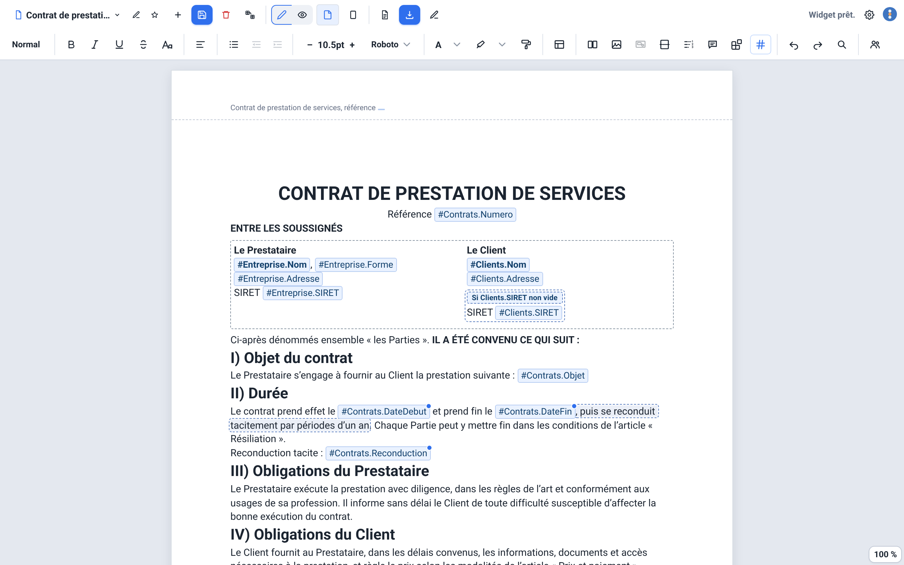
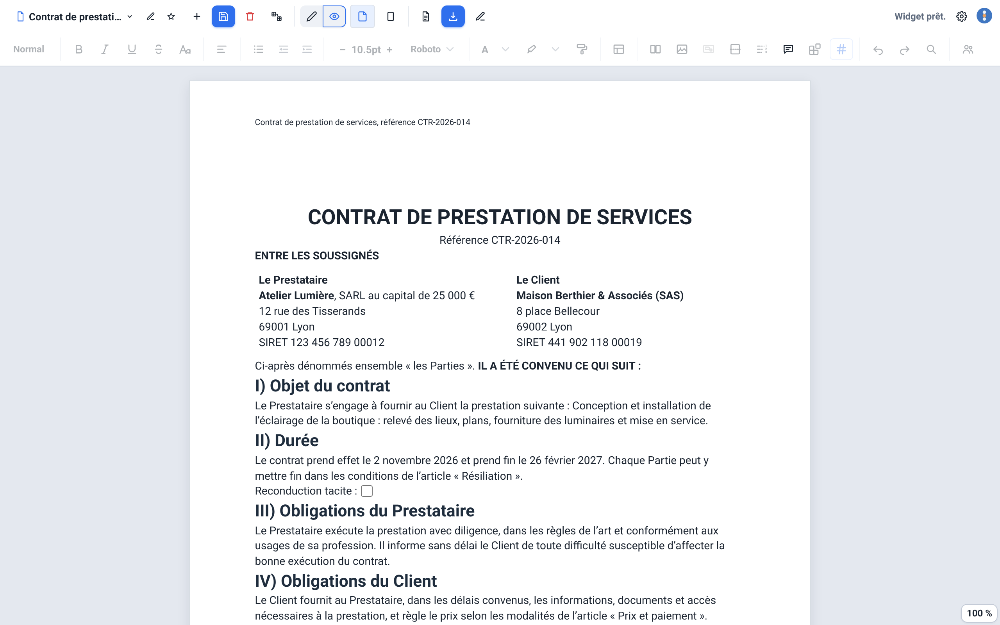
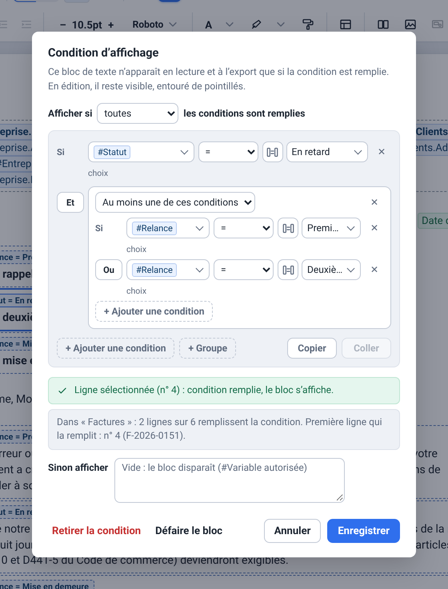
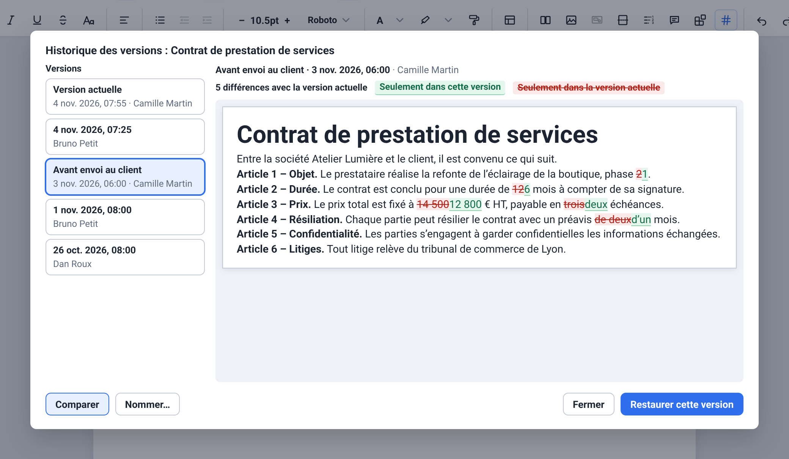
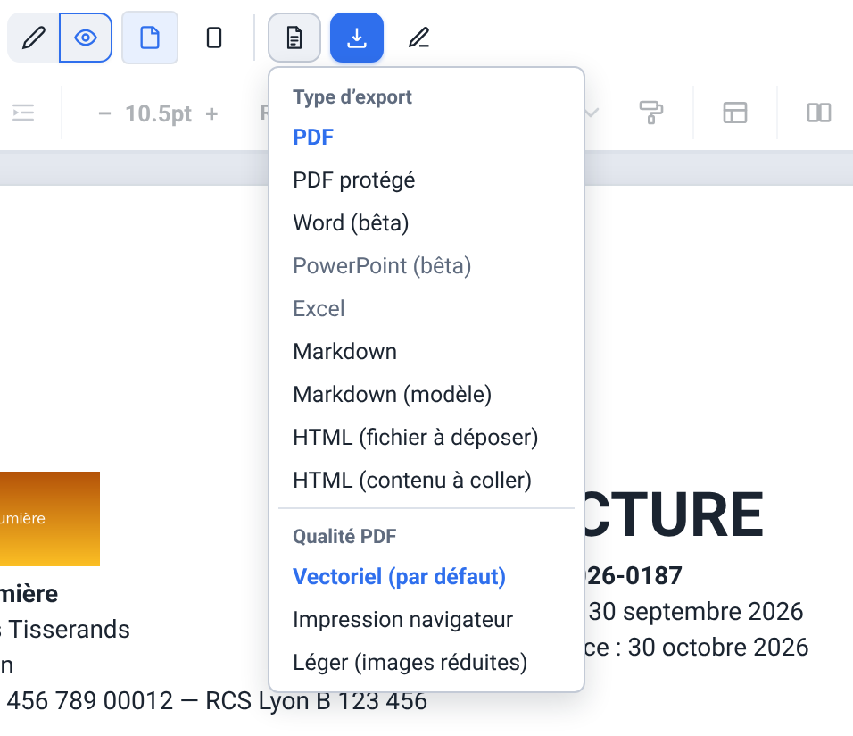

# Publipostage+ pour Grist

*🇬🇧 An English version of this document is available [at the bottom of this page](#publipostage-for-grist).*



**Publipostage+ est un éditeur de texte complet pour [Grist](https://www.getgrist.com/), avec publipostage et puces intelligentes.** Vous rédigez contrats, factures, courriers, e-mails ou étiquettes sans écrire une ligne de code : vous glissez dans le texte des **variables** qui viennent de n'importe quelle table du document (`#Table.Colonne`), vous les reformatez à l'affichage si besoin, puis vous lisez le document rempli avec une ligne de Grist et vous l'exportez en **PDF vectoriel** (le texte reste sélectionnable), en Word, en Excel, en Markdown ou en HTML, ou vous ouvrez un e-mail prérempli. Les exports se font ligne par ligne ou en lot.

Widget personnalisé conçu par [Grist Factory](https://grist-factory.fr). Moteur d'édition : [TipTap](https://tiptap.dev/)/ProseMirror. Le widget est une page statique unique, servie par GitHub Pages : aucune étape de build.

> **Ce dépôt est celui du développement.** La version publiée (V1.1, 1.1.2) est sur [grist-factory/Publipostage-Plus](https://github.com/grist-factory/Publipostage-Plus), dont le README, lui, s'adresse aux personnes qui utilisent le widget. Ici, `main` est servie en continu à `https://lombre33.github.io/publipostageGrist/` : c'est la version en cours, qui peut avoir de l'avance sur la V1.1.

**[Démarrage rapide](#démarrage-rapide)** · [En images](#en-images) · [Fonctionnalités](#fonctionnalités) · [Installation](#installation-dans-grist) · [Sécurité](#sécurité-et-permissions) · [Développer](#organisation-du-dépôt) · [Tests](#tests)

## Démarrage rapide

1. Dans une page Grist, ajoutez un widget **personnalisé** et collez `https://lombre33.github.io/publipostageGrist/`. Acceptez l'accès complet au document quand Grist le demande (voir [Sécurité et permissions](#sécurité-et-permissions)).
2. Liez le widget à la table dont les lignes fournissent les données : il suit la ligne sélectionnée.
3. Ouvrez le menu **Nouveau modèle** puis **Nouveau document**, ou **Créer à partir d'un modèle…** pour partir de la galerie.
4. Écrivez le texte et tapez `#` pour insérer une variable (`#Table.Colonne`).
5. Passez en **Mode lecture** pour voir le document rempli avec la ligne sélectionnée, puis **Exporter** (en PDF, le type d'export de départ).

## En images

Le vrai widget, avec des données fictives (interface en français ; elle existe aussi en anglais). La [visite complète](outils/depot-propre/public/README.md#visite-en-images) est dans le README public.

| Lecture : le document rempli | Conditions « Et » / « Ou » |
|---|---|
|  |  |

| Historique des versions | Types d'export |
|---|---|
|  |  |

## Fonctionnalités

Le détail, fonction par fonction, noms de fichiers compris, est dans [`planning/reference-fonctions-securite-dependances.md`](planning/reference-fonctions-securite-dependances.md). L'essentiel :

- **Quatre types de modèles** : Document (A3 à A6, portrait ou paysage, marges réglables), E-mail (lien `mailto:`), Grille (un tableur : collage depuis Excel, import `.xlsx`, export Excel) et Macro-modèle (une page de garde et des annexes choisies selon des règles sur la ligne).
- **Éditeur** : mise en forme complète (six polices de 8 à 72 pt, petites capitales, ombre, contour, interligne, retraits), titres numérotés, sommaire, tableaux, images, en-têtes et pieds de page, notes de bas de page, filigrane, blocs (citation, code, encadré, signature, QR code), rechercher / remplacer avec expressions régulières, aperçu A4 fidèle.
- **Variables et logique** : `#Table.Colonne` sur toutes les tables du document, fiches citées avec `@`, formats des nombres, dates et Oui / Non, puces intelligentes (date, heure, e-mail de la personne connectée, numéro de ligne), calculs, conditions « Et » / « Ou » avec « Sinon afficher », boucles (y compris dans une boucle, ou sur toutes les lignes d'une table), renommages suivis.
- **Lecture, enregistrement, collaboration** : mode lecture simple ou épuré, enregistrement automatique avec détection de conflit, historique des versions (comparer, nommer, restaurer), commentaires, suivi des modifications (bêta), droits par personne.
- **Exports** : PDF vectoriel (en trois qualités), PDF protégé (AES-256), export en lot (ZIP ou un seul PDF), assemblage avant impression, Word (bêta), Excel, Markdown (document ou modèle), HTML, e-mail.
- **Modèles** : plusieurs par document Grist, une galerie de 22 modèles prêts à l'emploi (21 sans Grist Factory Suite), import Markdown.
- **Interface** : français et anglais, thème clair, sombre ou celui du système, 62 raccourcis personnalisables, barre d'outils pensée pour un petit panneau (testée à 700 × 400).

**Avec Grist Factory Suite** (GFS, la suite d'applications de Grist Factory) : les présentations (diapositives, thèmes, diaporama avec vue intervenant, import et export PowerPoint), les graphiques, l'écriture en direct à plusieurs et la lecture de PDF se branchent au widget par des extensions (`extensions/`). Sans GFS, le widget grise leurs commandes et dit pourquoi. Où en est la liaison : [`GFS-ETAT.md`](GFS-ETAT.md).

## Installation dans Grist

1. Dans une page Grist, ajoutez un widget personnalisé et renseignez l'adresse `https://lombre33.github.io/publipostageGrist/`. Le dépôt est servi tel quel : toute copie hébergée en HTTPS sur un serveur statique convient aussi.
2. Accordez au widget l'accès complet au document (voir [Sécurité et permissions](#sécurité-et-permissions)).
3. Liez-le à la table dont les lignes serviront de source de données : le widget suit la ligne sélectionnée, comme un widget « détail » standard.
4. Au premier lancement, le widget crée ses tables internes `Publipostage_*` (avec votre accord) : ce premier lancement demande un droit de modification du document. Leurs pages sont rangées sous celle des modèles, repliée.
5. Après une mise à jour du widget, rechargez la page du document Grist.

Le bouton **Réglages** de la barre du haut ouvre neuf onglets (langue, thème, touche d'insertion, raccourcis, messagerie, marges, vue, accès, crédits) ; le tableau est dans la [référence](planning/reference-fonctions-securite-dependances.md#réglages).

## Sécurité et permissions

- **Accès complet** (`requiredAccess: 'full'`) : l'API des widgets personnalisés de Grist n'a pas de niveau entre « lecture d'une seule table » et « accès complet », et la résolution de variables vers une autre table, l'autocomplétion et les tables internes en ont besoin dès le chargement. Les Règles d'accès natives de Grist continuent de s'appliquer ; les « droits par personne » du widget (Réglages > Accès) ne sont qu'un verrou d'interface.
- **Aucune donnée n'est stockée hors de Grist** : le widget écrit dans ses neuf tables `Publipostage_*` et, dans vos tables, seulement dans les deux colonnes que vous choisissez : la date du dernier export PDF et les PDF joints à la ligne (jeton d'écriture demandé à chaque export, jeté à la fin). Le navigateur ne garde que des préférences d'interface.
- **Bibliothèques tierces** à versions figées, chargées depuis `esm.sh` (éditeur), `cdnjs.cloudflare.com` et `cdn.jsdelivr.net` (exports, avec intégrité SRI) et `docs.getgrist.com` (API de Grist). Politique de sécurité du contenu, HTML assaini, images d'autres sites seulement après un clic.
- **Signaler une vulnérabilité** : ne pas ouvrir d'issue publique, contacter l'équipe de maintenance directement.

Le détail (tables, stockage du navigateur, dépendances, audit) est dans la [référence](planning/reference-fonctions-securite-dependances.md#sécurité-et-permissions) et dans [`AUDIT_CODE.md`](AUDIT_CODE.md).

## Organisation du dépôt

| Chemin | Rôle |
|---|---|
| `index.html` | La page du widget : import map, feuilles de style, scripts. |
| `js/` | Le code du widget, un fichier par fonction (éditeur, barre d'outils, variables, exports, réglages…). |
| `css/` | Les feuilles de style. |
| `extensions/` | Le code des extensions de Grist Factory Suite, une par dossier (aujourd'hui `graphique/` : cinq scripts et deux feuilles de style, et `edition/` : quatre scripts et une feuille de style). Il ne se charge qu'au premier usage, et seulement si GFS dit l'extension active (`js/extensions.js` nomme les fichiers ; `index.html` n'en demande aucun). |
| `kit/` | Le kit de Grist Factory Suite, en sous-module Git à une version figée (`git submodule update --init kit` après un clonage). Seuls quatre de ses modules servent : le lecteur du message d'ambiance et la pose de l'ambiance sur la page (`js/gfs-ambiance.js`), puis le lecteur du message des correcteurs et la pose de la marque qui les coupe (`js/gfs-correcteurs.js`). Le dépôt public le reçoit en fichiers, sans sous-module. |
| `img/` | Le logo et les images de la fenêtre des nouveautés. |
| `templates-gallery/` | Les modèles de la galerie : `catalogue.json`, un dossier par modèle (texte, `pack.json` des tables et de la page, captures) et `families/` (les tables de chaque famille de modèles, avec leurs lignes d'exemple, qui ne servent qu'aux captures). |
| `templates-gallery-dev/` | Des modèles de test, chargés seulement quand l'adresse du widget contient `?dev`. |
| `dev-tests/` | La suite de tests, le harnais et le simulateur de Grist. |
| `planning/` | Les notes de conception par chantier, la feuille de route, la charte UI/UX et la [référence détaillée des fonctions](planning/reference-fonctions-securite-dependances.md). |
| `prototypes/` | Le prototype du suivi des modifications, avec ses tests, et `edition-live/` : l'essai isolé d'édition collaborative en direct (texte simple, sa propre adresse, aucun fichier du widget ; voir son `README.md`). |
| `outils/` | Les outils d'envoi d'une version vers le dépôt public (`outils/depot-propre/` : script, contrôles, essais, captures du README, documents publics). Rien n'y est poussé sans geste manuel, et rien n'en part sur le dépôt public, sauf les documents de `outils/depot-propre/public/` (README, notes de version, journal, carte du code…) et les captures de `public/screenshots/`, posés à sa racine. |
| `outils/depot-propre/public/CARTE_DU_CODE.md` | La carte du code : quel fichier fait quoi, par où commencer (en français et en anglais). C'est un document public : il part à la racine du dépôt public. |
| `AUDIT_CODE.md` | L'audit de code (qualité, sécurité, publication) du 12 septembre 2026. |
| `CAHIER_DES_CHARGES.md` | Le cahier des charges initial, gardé comme document historique. |
| `LICENSE` | La licence GNU GPL v3.0. |

Règle de modification : un fichier `css/` ou `js/` modifié monte son numéro `?v=` dans `index.html`, sinon le navigateur garde l'ancienne version en cache.

**Le README public** (`outils/depot-propre/public/README.md`, en français puis en anglais) et ses captures (`outils/depot-propre/public/screenshots/`) sont écrits à part de celui-ci : ils décrivent le widget seul, pour qui l'installe. Les captures se refont d'un geste (`bash outils/depot-propre/captures/lancer-tout.sh`) dès que l'éditeur change.

## Tests

La suite de `dev-tests/` compte 118 groupes de scénarios, joués dans un Chromium sans écran (un navigateur neuf par groupe), et 130 scripts Node (parcours rejoués à la vraie souris dans un panneau de 700×400, tests unitaires, contrôle d'hygiène du code). Elle couvre l'éditeur, les modes Lecture, Grille et E-mail, et les exports PDF, Word, PowerPoint et Excel. Le dernier contrôle complet (3 octobre 2026) a passé plus de 6 500 vérifications.

```bash
bash dev-tests/generate-harness.sh           # régénère _test-harness.html depuis index.html
node dev-tests/run-headless.mjs              # tous les groupes et tous les scripts
node dev-tests/run-headless.mjs comments     # seulement ce groupe
```

Le lanceur charge Playwright depuis `/opt/node22/lib/node_modules/playwright`, l'emplacement de l'environnement où la suite tourne aujourd'hui : ailleurs, ce chemin est à adapter. Quand les CDN sont injoignables, `bash dev-tests/offline-deps.sh` reconstruit un miroir local des dépendances. Le détail (groupes, pièges, tableau « fichier modifié → tests à lancer ») est dans [`dev-tests/README.md`](dev-tests/README.md).

Les tests tournent sur un simulateur de Grist : la résolution réelle des variables et des pièces jointes, un vrai document Grist, les autres navigateurs que Chromium et le rendu réel des fichiers Word ne sont pas couverts.

## État du projet

La V1.1 (1.1.2) est publiée sur le dépôt public. Ici, le développement continue : chaque évolution est publiée sur `main` puis servie par GitHub Pages. Les notes de conception de [`planning/`](planning/) disent, pour la plupart en tête de fichier, ce qui est livré et ce qui reste à faire ; [`planning/ROADMAP.md`](planning/ROADMAP.md) est la feuille de route.

Un audit de code complet (qualité, sécurité, conformité aux exigences de publication) a été réalisé le 12 septembre 2026, puis complété le 14 par un passage sur la performance et le code mort : voir [`AUDIT_CODE.md`](AUDIT_CODE.md). C'est un instantané : le code a beaucoup évolué depuis.

Limites connues : le widget demande l'accès complet au document ; Word et PowerPoint sont en bêta (les limites exactes sont dans la [référence](planning/reference-fonctions-securite-dependances.md#état-du-projet)) ; l'e-mail ne garde que le texte brut ; l'export Excel écrit des valeurs, jamais de formule ; pas encore faits : le remplissage d'un modèle avec des données d'exemple et les variantes multilingues d'un modèle.

## Licence

Ce projet est distribué sous licence [GNU General Public License v3.0](LICENSE) (GPLv3).

Copyright (C) 2026 lombre33

---
---

# Publipostage+ for Grist

*🇫🇷 Une version française de ce document est disponible [en haut de cette page](#publipostage-pour-grist).*


**Publipostage+ is a full text editor for [Grist](https://www.getgrist.com/), with mail merge and smart chips.** You write contracts, invoices, letters, e-mails or labels without writing a line of code: you drop **variables** from any table of the document into the text (`#Table.Column`), reformat them on display if needed, then read the document filled with a row of Grist and export it as a **vector PDF** (the text stays selectable), Word, Excel, Markdown or HTML, or open a pre-filled e-mail. Exports run one row at a time or in batch.

A custom widget made by [Grist Factory](https://grist-factory.fr). Editing engine: [TipTap](https://tiptap.dev/)/ProseMirror. The widget is a single static page served by GitHub Pages: no build step.

> **This is the development repository.** The published version (V1.1, 1.1.2) is at [grist-factory/Publipostage-Plus](https://github.com/grist-factory/Publipostage-Plus), whose README is written for the people who use the widget. Here, `main` is served continuously at `https://lombre33.github.io/publipostageGrist/`: it is the work in progress, which may be ahead of V1.1.

## Quick start

1. In a Grist page, add a **custom** widget and paste `https://lombre33.github.io/publipostageGrist/`. Grant full access to the document when Grist asks (see "Security" below).
2. Link the widget to the table whose rows provide the data: it follows the selected row.
3. Open the **New template** menu then **New document**, or **Create from a template…** to start from the gallery.
4. Write your text and type `#` to insert a variable (`#Table.Column`).
5. Switch to **Reading mode** to see the document filled with the selected row, then **Export** (as PDF, the default export type).

The [full tour in pictures](outils/depot-propre/public/README.md#tour-in-pictures) is in the public README.

## Features

The complete, feature-by-feature detail, file names included, is in [`planning/reference-fonctions-securite-dependances.md`](planning/reference-fonctions-securite-dependances.md) (in French). In short:

- **Four template types**: Document (A3 to A6, portrait or landscape, adjustable margins), E-mail (`mailto:` link), Grid (a spreadsheet: paste from Excel, `.xlsx` import, Excel export) and Macro template (a cover page and appendices chosen by rules on the row).
- **Editor**: full formatting (six fonts from 8 to 72 pt, small caps, shadow, outline, line spacing, indents), numbered headings, table of contents, tables, images, headers and footers, footnotes, watermark, blocks (quote, code, callout, signature, QR code), find / replace with regular expressions, faithful A4 preview.
- **Variables and logic**: `#Table.Column` across every table of the document, cited records with `@`, number, date and Yes / No formats, smart chips (date, time, connected user's e-mail, row number), calculations, "And" / "Or" conditions with "Otherwise show", loops (including loops in loops, or over all the rows of a table), tracked renames.
- **Reading, saving, collaboration**: standard or clean reading mode, autosave with conflict detection, version history (compare, name, restore), comments, track changes (beta), per-person rights.
- **Exports**: vector PDF (three qualities), protected PDF (AES-256), batch export (ZIP or a single PDF), sheet assembly before printing, Word (beta), Excel, Markdown (document or template), HTML, e-mail.
- **Templates**: several per Grist document, a gallery of 22 ready-to-use templates (21 without Grist Factory Suite), Markdown import.
- **Interface**: French and English, light, dark or system theme, 61 customizable shortcuts, a toolbar designed for a small panel (tested at 700 × 400).

**With Grist Factory Suite** (GFS, Grist Factory's suite of applications): presentations (slides, themes, a slide show with presenter view, PowerPoint import and export), charts, live multi-user editing and PDF reading plug into the widget through extensions (`extensions/`). Without GFS, the widget greys out their commands and says why. State of the integration: [`GFS-ETAT.md`](GFS-ETAT.md).

## Security

- **Full access** (`requiredAccess: 'full'`): Grist's custom widget API has no level between "read a single table" and "full access", and resolving variables from another table, autocomplete and the internal tables need it from the moment the widget loads. Grist's native Access Rules still apply; the widget's "per-person rights" (Settings > Access) are only an interface lock.
- **No data is stored outside of Grist**: the widget writes to its nine `Publipostage_*` tables and, in your tables, only to the column you choose for the date of the last PDF export. The browser only keeps interface preferences.
- **Third-party libraries** at pinned versions, loaded from `esm.sh` (editor), `cdnjs.cloudflare.com` and `cdn.jsdelivr.net` (exports, with SRI integrity) and `docs.getgrist.com` (Grist API). Content Security Policy, sanitized HTML, images from other sites only after a click.
- **To report a vulnerability**: do not open a public issue, contact the maintainers directly.

## Repository layout and tests

`index.html` is the widget page; `js/` and `css/` hold its code, one file per feature; `extensions/` holds the Grist Factory Suite extensions; `kit/` is the GFS kit, a Git submodule (`git submodule update --init kit` after cloning); `templates-gallery/` holds the gallery templates; `dev-tests/` holds the test suite, the harness and a Grist simulator; `planning/` holds the design notes; `outils/depot-propre/` holds the tools that prepare a release for the public repository (script, checks, tests, README screenshots, public documents). The table in the French part above says what each folder does. A modified `css/` or `js/` file bumps its `?v=` number in `index.html`, otherwise the browser keeps the old version in cache.

The test suite (118 scenario groups in a headless Chromium, 130 Node scripts) runs with `node dev-tests/run-headless.mjs`; when the CDNs are unreachable, `bash dev-tests/offline-deps.sh` builds a local mirror of the dependencies. Details: [`dev-tests/README.md`](dev-tests/README.md). The tests run against a Grist simulator.

The public README (`outils/depot-propre/public/README.md`, French then English) and its screenshots are written separately from this one: they describe the widget alone, for the people who install it. The screenshots are rebuilt in one command (`bash outils/depot-propre/captures/lancer-tout.sh`) whenever the editor changes.

## License

This project is distributed under the [GNU General Public License v3.0](LICENSE) (GPLv3).

Copyright (C) 2026 lombre33
