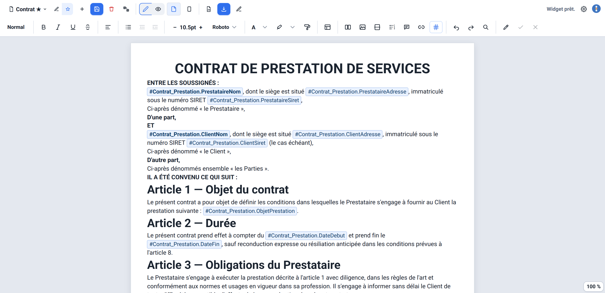
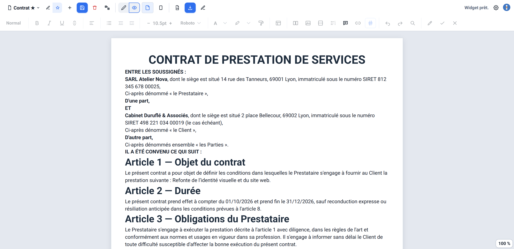

# Publipostage+ pour Grist

*🇬🇧 An English version of this document is available [at the bottom of this page](#publipostage-for-grist).*

> **Version bêta {{VERSION}}**, publiée le {{DATE_FR}}. Les fonctions décrites ci-dessous sont livrées,
> mais des défauts peuvent subsister : essayez le widget sur une copie de votre document avant de
> l'utiliser sur des données importantes. Les [limites connues](#limites-connues) et la
> [roadmap](#roadmap) disent ce qui manque encore.

Il s'agit d'un éditeur de texte avec publipostage et puces intelligentes. Il permet à n'importe qui de
rédiger des contrats, factures ou étiquettes sans écrire la moindre ligne de code, tout en pouvant
référencer une variable de n'importe quelle table du document et la reformater à l'affichage si
nécessaire !

C'est un widget personnalisé pour [Grist](https://www.getgrist.com/), conçu par
[Grist Factory](https://grist-factory.fr). Un document se lit rempli avec les données d'une ligne,
puis se télécharge en PDF vectoriel (texte sélectionnable), en Word, en Excel, en Markdown ou en HTML, ou s'envoie dans un
e-mail prérempli, ligne par ligne ou en lot.

## Aperçu

| Mode édition | Mode lecture |
|---|---|
|  |  |

## Sommaire

- [Fonctionnalités](#fonctionnalités)
- [Installation dans Grist](#installation-dans-grist)
- [Configuration](#configuration)
- [Sécurité et permissions](#sécurité-et-permissions)
- [Dépendances](#dépendances)
- [Limites connues](#limites-connues)
- [Note sur l'IA](#note-sur-lia)
- [Roadmap](#roadmap)
- [Contribuer](#contribuer)
- [Licence](#licence)

Moteur d'édition : [TipTap](https://tiptap.dev/)/ProseMirror. Le widget est une simple page statique
hébergée sur GitHub Pages, sans backend ni étape de build.

## Fonctionnalités

**Cinq types de modèles**
- Document : texte riche sur une page A3, A4, A5 ou A6, en portrait ou en paysage, avec des marges
  réglables par modèle
- E-mail : objet, destinataires et corps avec les mêmes variables, ouvert dans votre messagerie par un
  lien `mailto:`
- Grille : un tableau de type tableur à la place de la page, où l'on peut coller un tableau d'Excel, de
  Google Sheets ou de LibreOffice Calc, importer un classeur `.xlsx`, puis l'exporter en Excel
- Macro-modèle : une page de garde toujours incluse, suivie d'annexes (d'autres modèles) choisies selon
  des règles évaluées sur la même ligne ; des modèles en portrait, en paysage et des modèles Grille s'y
  mêlent, chacun sur une page de son sens (ou un seul sens est imposé à tous), jusque dans le PDF
- Présentation (avec Grist Factory Suite, « Nouvelle présentation » du menu « + ») : le même éditeur que le
  Document, sur une page 16:9 en paysage ; chaque saut de page commence une diapositive, et une bande de
  miniatures à gauche du texte mène à chacune, l'ajoute, la duplique, la déplace ou la supprime

**Mise en page**
- Mise en forme complète : gras, italique, souligné, barré, exposant et indice, couleurs et surlignage, six
  polices en tailles réelles de 8 à 72 points, alignement, retraits et tabulations (Tab, Maj+Tab), titres numérotés,
  pinceau de mise en forme
- Listes à puces, numérotées et de tâches à cocher
- Tableaux (fusion et scission de cases, fond de case, légende), zones 2 colonnes
- Images, y compris flottantes (habillage de texte, calque devant ou derrière, opacité, légende),
  collées, ajoutées par adresse ou prises dans une colonne Pièces jointes de Grist ; une image
  hébergée sur un autre site n'apparaît qu'après un clic sur « Afficher »
- En-têtes et pieds de page (première page différente, numéro de page, QR code), notes de bas de page, sommaire
  généré, sauts de page, filigrane
- Citation, bloc de code, encadré (Note, Attention, Important), bloc de signature, QR code, graphique de la
  page (un graphique réglé dans Grist, redessiné dans le document)
- Rechercher / remplacer (casse, mot entier, expression régulière, texte des bulles, en-tête et pied de page), abréviations qui se développent à la frappe
- Aperçu « format A4 » fidèle, WYSIWYG (ce que vous voyez est ce que vous obtenez)
- Zoom de la page à l'écran, en Édition comme en Lecture (pastille du coin, Ajuster, Ctrl + molette) : le
  PDF, le Word et l'impression gardent les dimensions réelles

**Variables Grist intelligentes**
- Autocomplétion `#Table.Colonne` sur toutes les tables du document, avec une clé de correspondance à
  configurer une fois pour les tables liées
- Fiches citées : `@` ouvre la liste des lignes de toutes les tables (« Rédigé par @Marie Martin ») ; le
  nom se relit à chaque affichage, renommer la personne dans Grist la renomme dans les modèles
- Mise en forme sur mesure des nombres (écriture française ou américaine, décimales, devise, en toutes
  lettres), des dates (formats prédéfinis, en toutes lettres) et des Oui/Non (texte ou case cochée)
- Puces intelligentes (date du jour, heure, e-mail de la personne connectée, numéro de ligne d'une
  boucle) et calculs (SOMME, MOYENNE, MIN, MAX, NB, ARRONDI)
- Conditions d'affichage (variable, bloc de texte, valeur dans la phrase, case cochée) et boucles sur
  les lignes liées (ligne de tableau, élément de liste, paragraphe), avec filtre, tri et séparateurs, y
  compris une boucle dans une boucle (les lignes de chaque facture, puis les étapes de chaque ligne),
  ou sur toutes les lignes d'une table (celles que la vue Grist du widget montre, ou toute la table)
- Renommages suivis : quand une table ou une colonne est renommée dans Grist, les modèles suivent

**Lecture, enregistrement et collaboration**
- Mode lecture (le document rempli avec la ligne sélectionnée) et lecture épurée, sans barre d'outils
- Enregistrement automatique avec détection d'un conflit si quelqu'un d'autre a enregistré le modèle
  entre-temps
- Historique des versions d'un modèle (menu du bouton Enregistrer) : qui a changé quoi et quand, aperçu de
  chaque version, « Comparer » avec la version actuelle (en vert ce que la version a en plus, en rouge barré
  ce qu'une restauration retirerait), « Nommer… » (une version nommée n'est jamais effacée par les plafonds)
  et « Restaurer cette version » (l'état remplacé reste dans la liste), dans une table à part que le widget
  ne lit qu'à l'ouverture de la fenêtre
- Commentaires sur le texte sélectionné, avec réponses et résolution, partagés entre les personnes qui
  ouvrent le document
- Suivi des modifications (bêta) : les changements sont proposés dans le texte, puis acceptés ou
  refusés un par un ou tous ensemble ; la barre Accepter / Refuser dit qui a proposé la modification
  (son nom, à défaut son adresse e-mail) ; le suivi, « Tout accepter » et « Tout refuser » sont
  rangés sous le bouton « Édition collaborative » de la barre d'outils
- Écriture en direct (avec Grist Factory Suite, ligne « Écriture en direct » du même menu) : plusieurs personnes
  écrivent en même temps le texte d'un même modèle Document, avec le curseur et le nom de chacune et une barre qui
  dit qui est là ; Annuler et Rétablir ne défont que les frappes de la personne, et une seule personne enregistre
  le modèle pour tout le monde
- Droits par personne (lecture seule, export, commentaires), lus dans une table du document
- Rangement personnel des modèles : épingles et dossiers que les autres personnes ne voient pas

**Export PDF, Word, Excel, Markdown, HTML**
- Export en PDF vectorisé, nom de fichier composé avec des variables
- Impression par le navigateur : la Lecture imprimée page pour page par la fenêtre d'impression (« Enregistrer
  au format PDF » ou une imprimante), avec la mise en page de la Lecture
- PDF « Léger » : le même PDF vectoriel dont les images sont ramenées à 150 points par pouce (une photo
  devient un JPEG, un logo transparent reste un PNG, une petite image et un code QR ne sont pas touchés), pour
  une ligne comme pour les lots
- PDF protégé : le même PDF vectoriel chiffré en AES-256, avec un mot de passe pour l'ouvrir (facultatif),
  des autorisations (imprimer, copier, modifier) et l'auteur, le sujet et les mots-clés du fichier, pour une
  ligne comme pour l'archive ZIP. Le mot de passe se donne de trois façons, au choix : saisi à chaque export
  (recommandé, il n'est écrit nulle part), le même pour tous les PDF et enregistré dans le document (en clair,
  table « Publipostage_Modeles », colonne « MotDePassePdf » : la fenêtre dit où et le risque), ou un par ligne,
  lu dans une colonne de la table (une ligne sans mot de passe utilisable n'est pas exportée et un lot la liste)
- Export en lot en un clic : un PDF par ligne dans une archive ZIP, ou toutes les lignes dans un seul
  PDF. Il suit les lignes que le widget affiche dans Grist (ses filtres, son tri, le lien « Sélectionner
  par ») : quand il n'en affiche qu'une partie, il demande s'il faut exporter celles-ci ou toute la table
- Assemblage avant impression : les pages de chaque ligne posées sur des feuilles A4 ou A3, avec ou
  sans traits de coupe, et une marge réglable autour de chaque page (quatre A6 sur une A4, par exemple)
- Date du dernier export PDF : une colonne de la table, choisie dans Réglages > Vue (Date, Date et heure
  ou Texte, sans formule), garde le moment du dernier export PDF de chaque ligne ; elle est écrite une
  fois le PDF produit, pour les lignes qui sont dans le fichier
- Word (`.docx`, bêta) et Excel (`.xlsx`, pour les grilles)
- Markdown (`.md`, CommonMark et GFM) : le document de la ligne avec les valeurs de ses variables ; ce que le Markdown écrit
  s'écrit en Markdown (titres, gras, italique, barré, liens, listes imbriquées, numérotées et à cases, citations, code,
  tableaux, notes de bas de page, sommaire en liens, encadrés en alertes GitHub), le reste (souligné, couleur, taille,
  police, alignement, saut de page, largeur d'une image) reste en HTML dans le fichier ; un fichier, ou un par ligne dans
  une archive ZIP
- Markdown (modèle) : le modèle lui-même, variables comprises, pour qu'il revienne intact par l'import. Un seul fichier,
  nommé d'après le modèle ; rien n'est lu dans Grist. Une variable sans réglage s'écrit `{{Table.Colonne}}` ; une variable
  réglée (format, condition, boucle, texte autour), un calcul, une puce de date, une pastille « @ », un numéro de page, une case ou un texte
  conditionnel, une image liée à une colonne, un code QR et un graphique s'écrivent en HTML en ligne avec leurs réglages ;
  l'en-tête et le pied de page sont écrits entre des commentaires. Les marges, le format de page, le filigrane, les images
  derrière le texte ou sur toutes les pages et le lien d'un tableau avec un modèle Grille ne sont pas gardés. Pas dans une
  grille ni dans un macro-modèle
- HTML (`.html`), pour un site web : le document de la ligne avec les valeurs de ses variables, qui coule comme une page web (ni feuilles A4, ni marges, ni
  numéros de page, ni filigrane ; l'en-tête et le pied de page sont écrits une fois). Deux lignes du menu « Type d'export » : « HTML (fichier à déposer) » écrit
  une page complète à poser telle quelle sur un site ; « HTML (contenu à coller) » écrit le seul contenu (`-fragment.html` : un `<style>` et un bloc
  `
`) à coller dans un bloc HTML d'un gestionnaire de contenu, sa feuille de style ne touchant que ce bloc. La mise en forme du document est
  gardée (titres, gras, italique, couleur, taille, listes, tableaux, encadrés, colonnes, notes de bas de page, sommaire) ; les images venues d'une pièce jointe de
  Grist, d'un graphique ou d'un code QR partent dans le fichier, celles d'un autre site gardent leur adresse. Aucun script n'est écrit. Les polices ne sont pas
  emportées (une police nommée reste nommée, avec des polices de repli), ni les marges, le format de page, les sauts de page, les images derrière le texte ou sur
  toutes les pages ; un fichier, ou un par ligne dans une archive ZIP. Pas dans une grille
- Avant un export, une fenêtre liste les sites externes dont des images seraient téléchargées

**Modèles**
- Gestion multi-modèles, sauvegardés directement dans le document Grist
- Import d'un fichier Markdown (`.md`, ligne « Importer un Markdown… » du menu « + ») : il devient un nouveau
  document ; les alertes GitHub deviennent des encadrés, les listes à cases des listes à cases, et le sommaire,
  les notes de bas de page, les sauts de page, l'en-tête et le pied de page que l'export écrit sont relus ; les
  variables `{{Table.Colonne}}` et les éléments de fusion que « Markdown (modèle) » écrit en HTML redeviennent ce qu'ils
  étaient (une clé qui n'est pas une variable du document reste du texte, et le coin d'état la compte) ; une
  image qui n'est ni en ligne ni dans le fichier n'est pas reprise (un mot le dit à sa place)
- Galerie de 21 modèles prêts à l'emploi : facture, contrat de prestation de services, attestation,
  courrier de relance, quittance de loyer, bulletin scolaire, fiche recette, émargement, bon de commande,
  fiche d'inventaire, et des modèles à imprimer (flyer A6, invitation, affiche A3, carte de visite, badge,
  étiquettes). Un modèle peut créer ses tables, vides, avec leurs colonnes de calcul et leurs liens, et son
  aperçu montre le document rempli en images (voir l'[avertissement](#limites-connues) à leur sujet)

**Autres**
- Interface bilingue français/anglais, thème clair, sombre ou celui du système
- 57 raccourcis clavier personnalisables
- Choix de la touche utilisée pour déclencher les variables (`#` par défaut)
- Barre d'outils pensée pour un petit panneau (testée à 700×400)

## Installation dans Grist

1. Dans une page Grist, ajoutez un widget personnalisé et collez cette URL :
   **`https://grist-factory.github.io/Publipostage-Plus/`**
   (toute copie de ce dépôt hébergée en HTTPS sur un serveur statique convient aussi)
2. Dans le panneau de configuration du widget, réglez **Select by** (« Sélectionner par ») sur la
   table dont les lignes serviront de source de données. C'est ce réglage qui permet au widget de
   suivre la ligne sélectionnée : sans lui, le mode lecture n'a pas de ligne à résoudre.
3. Grist demande une autorisation d'accès au chargement du widget (voir
   [Sécurité et permissions](#sécurité-et-permissions) plus bas) : elle est nécessaire au bon
   fonctionnement du widget.
4. Au premier lancement dans un document, le widget demande s'il peut y créer ses tables internes
   `Publipostage_*` (« Créer les tables du widget dans ce document ? ») : il faut donc avoir le droit de
   le modifier. Refusé, rien n'est créé ni enregistré, et la question revient à l'action suivante. Leurs
   pages sont rangées sous celle des modèles, repliée.
5. Après une mise à jour du widget, rechargez la page du document Grist, sans quoi le navigateur peut
   garder l'ancienne version.

Ouvert seul dans un onglet du navigateur, le widget ne fonctionne pas : il le dit et rappelle ces étapes.

**Premiers pas** : ouvrez le menu « Nouveau modèle » puis « Nouveau document » (ou « Créer à partir
d'un modèle… » pour partir de la galerie), écrivez le texte et tapez `#` pour insérer une variable.
Passez en mode lecture pour voir le document rempli avec la ligne sélectionnée, puis exportez-le.

## Configuration

- **Créer ou éditer un modèle** : bouton "Nouveau modèle", ou sélecteur de modèle en haut de
  l'éditeur. Chaque modèle est stocké dans une table Grist interne, créée avec votre accord (préfixée
  `Publipostage_`), qui n'apparaît pas dans les sélecteurs de table habituels.
- **Variables d'une autre table** : le panneau `#` propose un bouton dédié (« Tables liées ») pour
  configurer une fois pour toutes la correspondance entre deux tables (la « clé de correspondance »),
  valable pour tous les modèles du document.
- **En-tête et pied de page** : cliquez sur une marge en haut ou en bas de la page pour entrer dans
  l'édition dédiée. La zone garde sa taille (60 px de contenu) mais ne refuse rien : du texte, une image de n'importe quelle taille, un tableau (d'une ligne au départ) ou un QR code
  (adresse ou colonne, posé à 36 px) s'y posent comme dans le corps. Ce qui dépasse la bande est marqué d'un trait rouge en tirets, une note sous la feuille dit de combien (en
  millimètres) et, pour une image, propose « Réduire l'image » ; ce qui est sous le trait est coupé à l'impression, dans le PDF, dans Word et à la Lecture, et le texte de la page ne bouge jamais.
  Dans une zone, « Sommaire » et « Saut de page » sont grisés (une bande n'a ni liste de titres ni page à ouvrir) et un trait (« --- » puis Espace) reste même seul, avec le même aspect (fin, gris clair) ouvert, fermé et à la Lecture.
- **Réglages** (bouton de la barre du haut) : langue (celle du navigateur au premier lancement ; avec Grist Factory Suite, celle de GFS, que les cases ne changent pas), thème, touche déclenchant le panneau `#`,
  raccourcis clavier, marges du modèle, modèle par défaut de la vue, colonne de la date du dernier export PDF,
  droits par personne, crédits.
  Les réglages « Vue » et « Accès » sont des options du widget : Grist ne les partage avec les autres
  personnes qu'une fois la vue enregistrée.
- **Nom du fichier PDF** : champ dédié, qui accepte lui aussi des variables.

## Sécurité et permissions

Le widget demande le niveau d'accès `requiredAccess: 'full'`, c'est-à-dire un accès à l'ensemble du
document Grist et pas seulement à la table à laquelle il est lié. Ce niveau est nécessaire dans
l'architecture actuelle : la résolution de variables vers une autre table, l'autocomplétion sur tout le
document et la gestion des tables internes du widget en ont besoin dès le chargement. L'API des widgets
personnalisés Grist ne propose pas de niveau intermédiaire entre l'accès à une seule table et l'accès
complet.

Cet accès s'applique au widget, pas directement à chaque utilisateur : les Règles d'accès natives de
Grist, configurées sur le document par son propriétaire, continuent de s'appliquer normalement. Un
utilisateur restreint à certaines tables ou colonnes le reste en utilisant le widget. C'est donc au
niveau du document Grist lui-même que doit se faire une éventuelle restriction fine des données, pas
dans la configuration du widget. Les « droits par personne » du widget (Réglages > Accès) ne sont qu'un
verrou d'interface : ils grisent des commandes, ils ne protègent aucune donnée. Pour la même raison, un mot
de passe de PDF protégé écrit dans le document (« Le même pour tous, enregistré dans le document », ou les mots de
passe d'une colonne avec « Un par ligne ») y est lisible en clair par toute personne qui l'ouvre, sauf
permissions avancées de Grist sur cette colonne : « Saisi à chaque export » est la façon la plus sûre, et la
fenêtre le dit.

Le widget écrit dans neuf tables du document, toutes préfixées `Publipostage_` : `Publipostage_Modeles`
(les modèles, et une ligne « Réglages du document » qui garde les couleurs partagées par tous les
modèles et, seulement si vous choisissez « Le même pour tous, enregistré dans le document » pour un PDF protégé,
ce mot de passe commun, en clair, dans sa colonne `MotDePassePdf`), `Publipostage_Commentaires`, `Publipostage_PreferencesModeles` (épingles, dossiers et choix d'export
de chaque personne), `Publipostage_Abreviations`, `Publipostage_FormatsPage`, `Publipostage_LiensTables`
(les clés de correspondance entre tables), `Publipostage_Versions` (les versions gardées de chaque
modèle, créée à la première version gardée et lue seulement à l'ouverture de l'historique), `Publipostage_Direct` (le tuyau de l'écriture en direct, créée au premier
direct : les frappes en cours, une ligne par envoi, que la dernière personne qui part vide ; l'historique des actions de Grist, lui,
garde ce qui y a été écrit) et `Publipostage_UserProbe` (qui sert à lire l'e-mail de la
personne connectée). Il ne les crée qu'avec l'accord de la personne : avant la première création, une
fenêtre demande « Créer les tables du widget dans ce document ? » (« Créer les tables » ou « Ne pas
créer »). Un oui vaut jusqu'à la fermeture de la page ; un refus n'écrit rien, n'est jamais gardé, et la
question revient à l'action suivante de la personne. Un document qui porte déjà une table du widget ne
pose aucune question.

Dans les tables qui portent vos données, le widget n'écrit dans aucune colonne existante, sauf celle que
vous choisissez dans Réglages > Vue > « Date du dernier export PDF ». Il y écrit alors, après chaque PDF
réussi, le moment de l'export pour les lignes dont le PDF vient d'être produit (une seule écriture par
export) ; sans colonne choisie, il n'y écrit rien. Un compte Lecteur de Grist n'écrit rien.

Le widget charge des bibliothèques tierces à l'exécution, depuis `esm.sh` (moteur d'édition
TipTap/ProseMirror), `cdnjs.cloudflare.com` et `cdn.jsdelivr.net` (exports PDF, Word, Excel, lecteur de
l'import Markdown et QR code, chargés au premier usage) et `docs.getgrist.com` (API de Grist), à des versions figées, sauf le
script de l'API de Grist, que Grist sert dans sa version courante. Les fichiers venant de `cdnjs` et
de `jsDelivr` sont protégés par une intégrité SRI, qui empêche le navigateur d'exécuter un fichier
altéré ; ce n'est techniquement pas possible pour l'import map `esm.sh`. Aucune police ni feuille de
style ne vient d'un autre site. Le graphique de la page est une extension de Grist Factory Suite : sa bibliothèque (Plotly)
n'est pas chargée par le widget seul, c'est Grist Factory Suite qui la fournit.

La page porte une politique de sécurité du contenu (CSP) : seuls s'exécutent les scripts du widget,
ceux des adresses ci-dessus et trois scripts en ligne cités par leur empreinte. Les gestionnaires
d'événements en ligne, les adresses `javascript:`, les cadres, les objets et les formulaires sont
refusés. `'unsafe-eval'` y reste faute de mieux : le script d'API que sert Grist en a besoin. Le
HTML d'un modèle relu depuis le document, qu'une autre personne a pu modifier, est assaini avant
d'être affiché, et les formules de calcul ne passent jamais par `eval`. Les images et les connexions ne
sont pas limitées par la CSP : le widget lit des images et des pièces jointes de n'importe quel site.
Mais une image hébergée sur un autre site que le widget ou Grist ne se charge qu'après un clic sur
« Afficher » (dans l'éditeur, la Lecture, les en-têtes et pieds de page et la galerie), car la charger
apprend à ce site l'adresse IP de la personne et l'heure d'ouverture du document : le clic affiche toutes
les images de ce site jusqu'à la fermeture de la page, et rien n'est retenu, ni dans le navigateur ni dans
le document. Avant un export qui téléchargerait de telles images, une fenêtre liste les sites et demande
confirmation.

Aucune donnée n'est stockée hors de Grist. Les seules informations conservées dans le navigateur
(`localStorage`) sont des préférences d'interface (langue, thème, touches, raccourcis et vue de leur
panneau, messagerie du mode Email, état de l'enregistrement automatique, dernier choix de l'assemblage avant impression, autorisations
et auteur du PDF protégé, façon de donner son mot de passe et colonne des mots de passe - jamais un mot de passe), le niveau
de zoom de la page des derniers modèles ouverts (avec leur numéro et leur nom) et, pour suivre les
renommages, les noms des tables et des colonnes de chaque document ouvert, jamais de donnée de ligne.

Pour signaler une vulnérabilité, merci de ne pas ouvrir d'issue publique : suivez
[SECURITY.md](SECURITY.md).

## Dépendances

Aucune étape de build : tous les fichiers sont servis tels quels. Les bibliothèques tierces sont
chargées à l'exécution, à des versions toujours figées (sauf le script de l'API de Grist) :

| Bibliothèque | Usage | Origine |
|---|---|---|
| `grist-plugin-api.js` | API du widget Grist (obligatoire) | `docs.getgrist.com` |
| TipTap 3.31.3 + ProseMirror (une quinzaine de paquets) + `@floating-ui/dom` 1.6.12 | Moteur d'édition riche | `esm.sh` |
| `@handlewithcare/prosemirror-suggest-changes` 0.1.8 | Suivi des modifications | `esm.sh` |
| pdfmake 0.2.7 + `vfs_fonts` | Export PDF vectoriel | `cdnjs.cloudflare.com` |
| pdf-lib 1.17.1 | Un seul PDF pour toutes les lignes, assemblage avant impression | `cdnjs.cloudflare.com` |
| JSZip 3.10.1 | Export en lot (archive zip) | `cdnjs.cloudflare.com` |
| ExcelJS 4.4.0 | Export Excel | `cdnjs.cloudflare.com` |
| qrcode-generator 1.4.4 | QR code | `cdnjs.cloudflare.com` |
| marked 15.0.12 | Import Markdown | `cdnjs.cloudflare.com` |
| docx 9.7.1 | Export Word | `cdn.jsdelivr.net` |

Le graphique de la page est une extension de Grist Factory Suite (GFS) : son code est dans `extensions/graphique/`, mais
sa bibliothèque, Plotly 2.13.2, n'est pas dans cette liste : GFS la porte et la donne à l'extension, avec son empreinte. Le
widget seul (l'adresse de ce dépôt dans une fenêtre de Grist) grise la fonction, avec une fenêtre qui dit qu'il faut
passer par GFS. Seule la politique de sécurité du contenu de la page (décrite plus haut) garde l'adresse exacte de Plotly sur
`cdn.jsdelivr.net`, celle du catalogue de GFS, et rien d'autre pour le graphique : GFS ne peut imposer aucune politique à
un sous-cadre, et sans cette adresse le navigateur refuserait le script qu'il donne. Le widget seul ne la charge jamais.

L'écriture en direct est l'autre extension (code dans `extensions/edition/`) : sa bibliothèque, Yjs et les extensions de
TipTap qui s'en servent, n'est ni dans cette liste ni dans la carte d'importation. GFS la porte en un seul fichier
assemblé, qu'il sert à l'adresse de la page avec son empreinte et que le widget charge par `<script type="module">` :
la politique de sécurité du contenu n'a rien à y nommer. Le widget seul ne la charge jamais.

L'interface prend la police du système. Les polices des documents sont dans le dépôt : Roboto pour
l'éditeur, et pour le PDF Roboto, Arimo, Tinos, Cousine, Gelasio et Carlito, les équivalents libres de
même métrique d'Arial, Times New Roman, Courier New, Georgia et Calibri. Les licences de toutes ces
bibliothèques et polices sont dans [NOTICE](NOTICE).

## Limites connues

- **Accès complet au document** : faute de niveau intermédiaire dans Grist, le widget demande
  `requiredAccess: 'full'` (voir [Sécurité et permissions](#sécurité-et-permissions)). Il n'existe pas
  de version avec les dépendances embarquées, pour éviter tout appel externe.
- **Réseau** : `esm.sh` (éditeur) et `docs.getgrist.com` (API de Grist) sont nécessaires au démarrage ;
  `cdnjs.cloudflare.com` et `cdn.jsdelivr.net` le sont au premier export ou au premier import Markdown. Un pare-feu qui bloque l'un d'eux empêche le widget de démarrer ou l'export de se faire : il faut
  les autoriser. Au démarrage, le widget le dit dans une fenêtre qui liste ces adresses.
- **Audit externe** : un audit du code (outil gwaudit, 4 octobre 2026) conclut « NON CONFORME » et compte
  69 points bloquants. Tous tiennent à un seul choix : l'éditeur (TipTap et ProseMirror) se charge depuis
  `esm.sh`, un site tiers, sans intégrité SRI (ce qu'un import map ne permet pas ; voir
  [Dépendances](#dépendances)). Ce choix est gardé pour la bêta, donc le verdict reste « NON CONFORME », et
  l'outil en tire qu'un hébergement sur une instance officielle (DINUM, ANCT) est exclu en l'état. Le
  widget reste installable ailleurs : à chaque personne de juger si ce risque convient à son usage.
- **Navigateurs** : les tests automatisés tournent sur Chromium (Chrome, Edge), avec un simulateur de
  Grist ; Firefox et Safari ne sont pas testés automatiquement.
- **Enregistrement** : deux personnes qui modifient le même modèle en même temps ne sont pas fusionnées.
  L'enregistrement automatique détecte qu'une autre personne a enregistré entre-temps et propose de
  recharger la dernière version ; le bouton « Enregistrer » écrase la version enregistrée sans le
  vérifier. Il n'y a pas de co-édition en temps réel, sauf l'écriture en direct (avec Grist Factory Suite), qui ne couvre
  que le texte d'un modèle Document.
- **Écriture en direct** (avec Grist Factory Suite) : elle ne couvre que le texte d'un modèle Document. Tant qu'elle
  dure, l'en-tête et le pied de page, le suivi des modifications, les tableaux liés et la restauration d'une version sont
  grisés, avec leur raison ; un modèle e-mail, une grille ou un macro-modèle ne s'écrit pas en direct. Une seule personne
  enregistre le modèle pour tout le monde (la première de la liste, parmi les pages visibles ; si elle ferme sa page, la
  suivante prend le relais). Une frappe apparaît chez l'autre en quelques dixièmes de seconde (mesuré sans réseau :
  environ 90 ms avec la prévenance de Grist, environ 125 ms de plus quand la table du direct n'est pas celle de la
  section, relue toutes les 250 ms) ; le réseau réel d'un Grist en ligne, deux navigateurs et les plafonds de l'offre ne
  sont pas mesurés. Les frappes passent par la table `Publipostage_Direct` : l'historique des actions de Grist grossit
  pendant qu'on écrit et garde ce qui y a été écrit.
- **Suivi des modifications** (bêta) : la version complète est prévue en V1.
- **PDF** : les caractères chinois, arabes, hébreux, thaï et la plupart des émojis ne sont pas pris en
  charge (une case vide les remplace) ; le grec, le cyrillique, le vietnamien, les flèches, coches,
  étoiles et monnaies le sont. Le menu « Type d'export » propose PDF, PDF protégé, Word, Excel, Markdown, Markdown (modèle) et les deux HTML (fichier à déposer, contenu à coller), puis, pour le PDF, « Vectoriel », « Impression navigateur » et « Léger » (le PDF
  vectoriel aux images ramenées à 150 points par pouce). L'impression navigateur imprime une
  ligne à la fois, sur 60 pages au plus, et suppose que le navigateur ouvre sa fenêtre d'impression depuis le
  cadre du widget : si rien ne s'ouvre, choisissez « Vectoriel ». Un PDF protégé n'existe ni en un seul PDF pour
  toutes les lignes, ni en assemblage avant impression, ni par l'impression navigateur (ces sorties ne se
  chiffrent pas) ; sans mot de passe pour l'ouvrir, ses autorisations (imprimer, copier, modifier) ne tiennent que
  chez les visionneuses qui les respectent.
- **Word** (bêta) : les images devant ou derrière le texte et celles alignées à gauche ou à droite y
  gardent leur place, le sommaire est un vrai sommaire Word dont les numéros de page ne s'écrivent que
  quand Word le met à jour, et les polices ne sont pas embarquées.
- **E-mail** : le corps est du texte brut (l'éditeur d'un modèle e-mail n'écrit ni gras, ni couleur, ni
  niveau de titre, ni image : le texte du lien a les lignes de l'éditeur), sans pièce jointe ; le lien
  `mailto:` est limité à environ 2 000 caractères, une jauge prévient quand il les dépasse.
- **Excel** : le fichier contient des valeurs, jamais de formule.
- **Accessibilité** : pas d'audit RGAA complet à ce jour ; les contrastes, le focus et les fenêtres
  (Tab, Échap) ont été travaillés.
- **Droits par personne** : un verrou d'interface, pas une protection des données (voir
  [Sécurité et permissions](#sécurité-et-permissions)).
- **Modèles de la galerie** : ce sont des exemples de mise en page, écrits pour le droit français. Ils
  ne constituent ni un avis ni un conseil juridique et ne sont pas garantis conformes à la loi en
  vigueur (mentions obligatoires, pénalités de retard, clauses…) : faites-les relire avant tout usage.
- **Import Markdown** : seules les variables écrites `{{Table.Colonne}}` sont reconnues (un `#Table.Colonne` écrit
  à la main dans le fichier reste du texte, comme une clé `{{…}}` qui n'est pas une variable du document) ; la
  numérotation des titres, écrite dans leur texte par l'export (« 1) Titre »), revient comme du texte ; les marges,
  le format de page, le filigrane, l'objet et les destinataires d'un e-mail ne sont pas écrits dans un fichier
  Markdown, donc ne reviennent pas ; une image qui n'est ni en ligne ni dans le fichier n'est pas reprise ; un fichier de plus de 10 Mo est
  refusé. Le lecteur lit des fichiers de confiance : un texte fait pour le piéger (des milliers de crochets ou
  d'étoiles jamais fermés) peut bloquer la page de longues secondes.
- **Pas encore faits** : remplissage des tables d'un modèle avec des lignes d'exemple (l'aperçu de la
  galerie en montre en images, mais les tables créées restent vides), variantes multilingues d'un
  modèle, codes-barres (le QR code est livré).

## Note sur l'IA

Ce widget a été réalisé avec l'aide de Claude Code, avec le modèle Claude Sonnet 5 en mode Ultra Code.
Le code a été relu par un humain (moi), mais je manque de tokens pour être aussi efficace que Claude.

La version Bêta sera aussi l'occasion de corriger ou refacto certains éléments si nécessaire : le
dépôt est ouvert à la collaboration (cf. ci-après).

## Roadmap

De nombreuses fonctionnalités sont prévues et seront ajoutées progressivement dans les prochaines
semaines. N'hésitez pas à réagir aux issues de ce dépôt, ou à m'écrire sur Tchap, pour m'aider à les
prioriser.

**Édition collaborative**
- Suivi des modifications : version complète (V1)

**Édition augmentée**
- Codes-barres, en plus du QR code (V1)
- Remplissage d'un modèle avec des données d'exemple, pour le prévisualiser sans ligne réelle
- Modèles multilingues : variantes d'un même modèle (V1)

**Import / Export**
- Import Markdown : fiabilité à confirmer sur des exports réels de Docs de La Suite (V1)

**Confort d'utilisation**
- Optimisation du chargement (V1)

**Sécurité**
- Version lecture seule : préparer un modèle sur Docs, puis exporter/importer pour une session en
  lecture seule, avant export (V1)

## Contribuer

Les contributions sont bienvenues : signaler un défaut, proposer une fonction, envoyer une correction.
Commencez par [CONTRIBUTING.md](CONTRIBUTING.md) ; le [code de conduite](CODE_OF_CONDUCT.md) s'applique à
tous les échanges. Pour vous repérer dans le code (quel fichier fait quoi, par où commencer), lisez la
[carte du code](CARTE_DU_CODE.md). Les changements de chaque version sont dans
[CHANGELOG.md](CHANGELOG.md).

## Licence

Ce projet est distribué sous licence [GNU General Public License v3.0](LICENSE) (GPLv3).

Copyright (C) 2026 Grist Factory

Les bibliothèques et les polices tierces gardent leurs propres licences : voir [NOTICE](NOTICE).
« Grist » est un produit de Grist Labs ; Publipostage+ est un widget tiers, qui n'est pas publié par
Grist Labs.

---
---

# Publipostage+ for Grist

*🇫🇷 Une version française de ce document est disponible [en haut de cette page](#publipostage-pour-grist).*

> **Beta version {{VERSION}}**, released on {{DATE_EN}}. The features described below are delivered,
> but defects may remain: try the widget on a copy of your document before using it on important data.
> The [known limitations](#known-limitations) and the [roadmap](#roadmap-1) say what is still missing.

This is a text editor with mail merge and smart chips. It lets anyone write contracts, invoices or
labels without writing a single line of code, while being able to reference a variable from any table
in the document and reformat it on display if needed!

It is a custom widget for [Grist](https://www.getgrist.com/), made by
[Grist Factory](https://grist-factory.fr). A document is read filled with the data of one row, then
downloaded as a vector PDF (selectable text), as Word, Excel, Markdown or HTML, or sent in a pre-filled e-mail, row by
row or in batch.

## Preview

| Editing mode | Reading mode |
|---|---|
|  |  |

## Table of contents

- [Features](#features)
- [Installing in Grist](#installing-in-grist)
- [Configuration](#configuration-1)
- [Security and permissions](#security-and-permissions)
- [Dependencies](#dependencies)
- [Known limitations](#known-limitations)
- [A note on AI](#a-note-on-ai)
- [Roadmap](#roadmap-1)
- [Contributing](#contributing)
- [License](#license)

Editing engine: [TipTap](https://tiptap.dev/)/ProseMirror. The widget is a plain static page hosted on
GitHub Pages, with no backend and no build step.

## Features

**Five template types**
- Document: rich text on an A3, A4, A5 or A6 page, portrait or landscape, with margins you can set per
  template
- E-mail: subject, recipients and body with the same variables, opened in your mail client through a
  `mailto:` link
- Grid: a spreadsheet-like table in place of the page, where you can paste a table from Excel, Google
  Sheets or LibreOffice Calc, import an `.xlsx` workbook, then export it to Excel
- Macro template: a cover page that is always included, followed by appendices (other templates) chosen
  by rules evaluated on the same row; portrait, landscape and Grid templates can be mixed in it, each on a
  page of its own orientation (or one orientation imposed on all), down to the PDF
- Presentation (with Grist Factory Suite, "New presentation" in the "+" menu): the same editor as the Document,
  on a 16:9 page in landscape; each page break starts a slide, and a strip of thumbnails to the left of the
  text leads to each one, adds, duplicates, moves or deletes it

**Layout**
- Full formatting: bold, italic, underline, strikethrough, superscript and subscript, colors and highlighting,
  six fonts in real point sizes from 8 to 72, alignment, indents and tabs (Tab, Shift+Tab), numbered headings, format painter
- Bullet lists, numbered lists and checkable task lists
- Tables (merging and splitting cells, cell background, caption), two-column zones
- Images, including floating ones (text wrap, layered in front of/behind, opacity, caption), pasted,
  added by address or taken from a Grist Attachments column; an image hosted on another site only
  appears after a click on "Show"
- Headers and footers (different first page, page number, QR code), footnotes, generated table of contents,
  page breaks, watermark
- Quote, code block, callout (Note, Warning, Important), signature block, QR code, chart from the page (a
  chart set up in Grist, redrawn in the document)
- Find / replace (match case, whole word, regular expression, bubble text, header and footer), abbreviations that expand as you type
- Faithful "A4 format" preview, WYSIWYG (what you see is what you get)
- On-screen page zoom, in Edit and Reading modes (corner pill, Fit, Ctrl + wheel): the PDF, the Word file
  and printing keep the real dimensions

**Smart Grist variables**
- `#Table.Column` autocomplete across every table in the document, with a matching key to set up once
  for linked tables
- Cited records: `@` opens the list of rows from every table ("Written by @Marie Martin"); the name is
  read again each time the document is shown, so renaming the person in Grist renames them in templates
- Tailored formatting for numbers (French or US notation, decimals, currency, spelled out), dates
  (predefined formats, spelled out) and Yes/No values (text or checked box)
- Smart chips (today's date, time, connected user's e-mail) and calculations (SUM, AVERAGE, MIN, MAX,
  COUNT, ROUND)
- Display conditions (variable, text block, value in a sentence, checked box) and loops over linked
  rows or over all the rows of a table (the ones the widget's Grist view shows, or the whole table)
  (table row, list item, paragraph), with filter, sort and separators
- Tracked renames: when a table or a column is renamed in Grist, templates follow

**Reading, saving and collaboration**
- Reading mode (the document filled with the selected row) and clean reading, without the toolbar
- Autosave with conflict detection if someone else saved the template in the meantime
- Version history of a template (Save button menu): who changed what and when, a preview of each version,
  "Compare" with the current version (green for what the version has in addition, struck-through red for
  what a restore would remove), "Name…" (a named version is never erased by the caps) and "Restore this
  version" (the replaced state stays in the list), in a table of its own that the widget only reads when
  the window is opened
- Comments on the selected text, with replies and resolution, shared between the people who open the
  document
- Track changes (beta): changes are proposed in the text, then accepted or rejected one by one or all
  together; the Accept / Reject bar says who proposed the change (their name, or their e-mail address
  when there is no name); track changes, "Accept all" and "Reject all" sit under the "Collaborative
  editing" button of the toolbar
- Live editing (with Grist Factory Suite, "Live editing" row of the same menu): several people write the text of the
  same Document template at the same time, with each person's cursor and name and a bar saying who is there; Undo and
  Redo only undo the person's own typing, and one person saves the template for everyone
- Per-person rights (read-only, export, comments), read from a table of the document
- Personal organization of templates: pins and folders that other people don't see

**PDF, Word, Excel, Markdown, HTML export**
- Vector PDF export, file name built with variables
- Browser print: the Reading view printed page by page through the print window ("Save as PDF" or a printer),
  with the layout of the Reading view
- Light PDF: the same vector PDF with its images brought down to 150 points per inch (a photo becomes a JPEG,
  a transparent logo stays a PNG, a small image and a QR code are left alone), for one row and for batches
- Protected PDF: the same vector PDF encrypted with AES-256, with a password to open it (optional),
  permissions (print, copy, edit) and the file's author, subject and keywords, for one row and for the ZIP
  archive. The password comes in three ways, your choice: typed at each export (recommended, it is written
  nowhere), the same for all the PDFs and saved in the document (in plain text, table "Publipostage_Modeles",
  column "MotDePassePdf": the window says where and the risk), or one per row, read from a column of the table (a
  row with no usable password is not exported and a batch lists it)
- Batch export in one click: one PDF per row in a ZIP archive, or all rows in a single PDF. It follows
  the rows the widget shows in Grist (its filters, its sort, the "Select by" link): when it only shows
  part of the table, it asks whether to export those or the whole table
- Sheet assembly before printing: each row's pages laid out on A4 or A3 sheets, with or without crop
  marks, and an adjustable margin around each page (four A6 on one A4, for example)
- Date of the last PDF export: a column of the table, chosen in Settings > View (Date, Date and time or
  Text, no formula), keeps the moment of each row's last PDF export; it is written once the PDF is made,
  for the rows that are in the file
- Word (`.docx`, beta) and Excel (`.xlsx`, for grids)
- Markdown (`.md`, CommonMark and GFM): the row's document with the values of its variables; what Markdown can write
  is written in Markdown (headings, bold, italic, strikethrough, links, nested, numbered and task lists, quotes, code,
  tables, footnotes, a linked table of contents, callouts as GitHub alerts), the rest (underline, colour, size, font,
  alignment, page break, image width) stays as HTML in the file; one file, or one per row in a ZIP archive
- Markdown (template): the template itself, variables included, so that it comes back intact through the import. One
  file, named after the template; nothing is read from Grist. A variable with no settings is written `{{Table.Column}}`;
  a variable with settings (format, condition, loop, surrounding text), a calculation, a date chip, an "@" chip, a page number, a
  conditional checkbox or text, an image linked to a column, a QR code and a chart are written as inline HTML with their
  settings; the header and footer are written between comments. Margins, page format, watermark, images behind the text
  or on every page and the link of a table with a Grid template are not kept. Not available in a grid or a
  macro-template
- HTML (`.html`), for a website: the row's document with the values of its variables, flowing like a web page (no A4 sheets, no margins, no page numbers, no
  watermark; the header and the footer are written once). Two rows of the "Export type" menu: "HTML (file to upload)" writes a complete page to put on a
  site as it is; "HTML (content to paste)" writes the content alone (`-fragment.html`: a `<style>` and a `
` block) to paste into an HTML block of a
  content manager, its stylesheet only touching that block. The document's formatting is kept (headings, bold, italic, colour, size, lists, tables, callouts,
  columns, footnotes, table of contents); images coming from a Grist attachment, a chart or a QR code go into the file, those from another site keep their
  address. No script is written. Fonts are not carried along (a named font stays named, with fallback fonts), nor are the margins, the page format, page
  breaks, images behind the text or on every page; one file, or one per row in a ZIP archive. Not available in a grid
- Before an export, a window lists the external sites that images would be downloaded from

**Templates**
- Multi-template management, saved directly in the Grist document
- Import of a Markdown file (`.md`, the "Import from Markdown…" line of the "+" menu): it becomes a new document;
  GitHub alerts become callouts, task lists become task lists, and the table of contents, footnotes, page breaks,
  header and footer that the export writes are read back; the `{{Table.Column}}` variables and the merge elements that
  "Markdown (template)" writes as HTML come back as they were (a key that is not a variable of the document stays
  text, and the status corner counts it); an image that is neither online nor in the file is not
  imported (a word says so in its place)
- Gallery of 21 ready-to-use templates: invoice, service agreement, certificate, payment reminder letter,
  rent receipt, school report, recipe sheet, attendance sheet, purchase order, inventory sheet, and
  templates to print (A6 flyer, invitation, A3 poster, business card, badge, labels). A template can create
  its tables, empty, with their calculated columns and links, and its preview shows the filled document as
  images (see the [warning](#known-limitations) about them)

**Other**
- Bilingual French/English interface, light, dark or system theme
- 57 customizable keyboard shortcuts
- Choice of key used to trigger variables (`#` by default)
- Toolbar designed for a small panel (tested at 700×400)

## Installing in Grist

1. In a Grist page, add a custom widget and paste this URL:
   **`https://grist-factory.github.io/Publipostage-Plus/`**
   (any copy of this repository hosted over HTTPS on a static server works too)
2. In the widget's configuration panel, set **Select by** to the table whose rows will be the data
   source. This is what lets the widget follow the selected row: without it, reading mode has no row to
   resolve against.
3. Grist will ask for an access permission when the widget loads (see
   [Security and permissions](#security-and-permissions) below): granting it is required for the widget
   to work.
4. On first launch in a document, the widget asks whether it may create its internal `Publipostage_*`
   tables there ("Create the widget’s tables in this document?"), so you need the right to edit it. If
   you decline, nothing is created or saved, and the question comes back at your next action. Their pages
   are filed under the templates page, collapsed.
5. After a widget update, reload the Grist document's page, otherwise the browser may keep the old
   version.

Opened alone in a browser tab, the widget does not work: it says so and recalls these steps.

**Getting started**: open the "New template" menu then "New document" (or "Create from a template…" to
start from the gallery), write the text and type `#` to insert a variable. Switch to reading mode to
see the document filled with the selected row, then export it.

## Configuration

- **Create or edit a template**: the "New template" button, or the template picker at the top of the
  editor. Each template is stored in an internal Grist table, created with your consent (prefixed
  `Publipostage_`), which doesn't show up in the usual table pickers.
- **Variables from another table**: the `#` panel has a dedicated button ("Linked tables") to set up the
  relationship between two tables once, for good (the "matching key"), valid for every template in the
  document.
- **Header and footer**: click a margin at the top or bottom of the page to enter dedicated editing. The zone keeps its size (60 px of content) but refuses nothing: text, an image of any
  size, a table (one row to start with) or a QR code (an address or a column, placed at 36 px) go in like in the body. Whatever goes beyond the band is marked with a red dashed line, a
  note under the sheet says by how much (in millimetres) and, for an image, offers "Shrink the image"; what is below the line is cut when printed, in the PDF, in Word and in Reading
  mode, and the text of the page never moves. In a zone, "Insert a table of contents" and "Page break" are greyed out (a band has no list of headings and no page to open) and a line
  ("---" then Space) stays even on its own, with the same look (thin, light grey) open, closed and in Reading mode.
- **Settings** (button in the top bar): language (the browser's at first launch; with Grist Factory Suite, GFS's, which the boxes do not change), theme, the key that triggers the `#` panel, keyboard
  shortcuts, the template's margins, the view's default template, the column that keeps the date of the
  last PDF export, per-person rights, credits. The
  "View" and "Access" settings are widget options: Grist only shares them with other people once the
  view is saved.
- **PDF file name**: its own field, which also accepts variables.

## Security and permissions

The widget requests `requiredAccess: 'full'`, meaning access to the whole Grist document rather than
just the table it's linked to. This is needed by the current architecture: resolving variables from
another table, autocompleting across the whole document, and managing the widget's own internal tables
all need it from the moment the widget loads. Grist's custom widget API doesn't offer a middle ground
between single-table access and full access.

This access applies to the widget, not directly to each user: Grist's native Access Rules, set on the
document by its owner, still apply as normal. A user restricted to certain tables or columns stays
restricted while using the widget. Any fine-grained restriction of the data should therefore happen at
the Grist document level, not in the widget's configuration. The widget's "per-person rights"
(Settings > Access) are only an interface lock: they grey out commands, they don't protect any data. For the same reason, a protected PDF's
password written in the document ("Same for all, saved in the document", or the passwords of a column with "One
per row") can be read there in plain text by anyone who opens it, unless advanced Grist permissions cover that
column: "Typed at each export" is the safest way, and the window says so.

The widget writes to nine tables of the document, all prefixed `Publipostage_`: `Publipostage_Modeles`
(the templates, and a "Réglages du document" row that keeps the colors shared by every template and, only if
you choose "Same for all, saved in the document" for a protected PDF, that shared password, in plain text, in its
`MotDePassePdf` column), `Publipostage_Commentaires`, `Publipostage_PreferencesModeles` (each person's pins, folders and
export choices), `Publipostage_Abreviations`, `Publipostage_FormatsPage`, `Publipostage_LiensTables` (the
matching keys between tables), `Publipostage_Versions` (the versions kept for each template, created
when the first version is kept and only read when the history is opened), `Publipostage_Direct` (the pipe of live editing, created at the first live
session: the typing in progress, one row per send, emptied by the last person to leave; Grist's action history, for its part, keeps
what was written in it) and `Publipostage_UserProbe` (used to read the connected user's e-mail). It
only creates them with the person's consent: before the first creation, a window asks "Create the
widget’s tables in this document?" ("Create the tables" or "Don’t create"). A yes holds until the page
is closed; a refusal writes nothing, is never remembered, and the question comes back at the person's
next action. A document that already has one of the widget's tables is never asked.

In the tables that hold your data, the widget writes to no existing column, except the one you choose in
Settings > View > "Date of the last PDF export". It then writes there, after each successful PDF, the
moment of the export for the rows whose PDF has just been made (a single write per export); with no
column chosen, it writes nothing there. A Grist Viewer account writes nothing.

The widget loads third-party libraries at runtime, from `esm.sh` (the TipTap/ProseMirror editing
engine), `cdnjs.cloudflare.com` and `cdn.jsdelivr.net` (PDF, Word, Excel, the Markdown import reader and QR code,
loaded on first use) and `docs.getgrist.com` (the Grist API), at pinned versions, except the Grist API script, which
Grist serves in its current version. Files from `cdnjs` and `jsDelivr` are protected by SRI integrity
hashes, which stop the browser from running a tampered file; this isn't technically possible for the
`esm.sh` import map. No font or stylesheet comes from another site. The chart from the page is a Grist Factory Suite
extension: its library (Plotly) is not loaded by the widget alone, Grist Factory Suite provides it.

The page carries a Content Security Policy (CSP): only the widget's own scripts, those of the addresses
above and three inline scripts cited by their hash are allowed to run. Inline event handlers,
`javascript:` addresses, frames, objects and forms are refused. `'unsafe-eval'` remains for lack of a
better option: the API script that Grist serves needs it. The HTML of a template read back from the
document, which another person may have edited, is sanitized before being displayed, and calculation
formulas never go through `eval`. Images and connections are not limited by the CSP: the widget reads
images and attachments from any site. Still, an image hosted on a site other than the widget's or
Grist's only loads after a click on "Show" (in the editor, Reading mode, headers and footers and the
gallery), because loading it tells that site the person's IP address and when the document was opened:
the click shows every image from that site until the page is closed, and nothing is remembered, neither
in the browser nor in the document. Before an export that would download such images, a window lists the
sites and asks for confirmation.

No data is ever stored outside of Grist. The only things kept in the browser (`localStorage`) are
interface preferences (language, theme, keys, shortcuts and the view of their panel, mail program of the Email mode, autosave state, last
choice in the sheet assembly before printing, permissions and author of the protected PDF, the way its
password is given and the password column - never a password), the page zoom level of the last templates opened (with
their number and name) and, to follow renames, the names of the tables and columns of each open
document, never any row data.

To report a vulnerability, please don't open a public issue: follow [SECURITY.md](SECURITY.md).

## Dependencies

No build step: every file is served as-is. Third-party libraries are loaded at runtime, always at
pinned versions (except the Grist API script):

| Library | Purpose | Source |
|---|---|---|
| `grist-plugin-api.js` | Grist widget API (required) | `docs.getgrist.com` |
| TipTap 3.31.3 + ProseMirror (about fifteen packages) + `@floating-ui/dom` 1.6.12 | Rich text editing engine | `esm.sh` |
| `@handlewithcare/prosemirror-suggest-changes` 0.1.8 | Track changes | `esm.sh` |
| pdfmake 0.2.7 + `vfs_fonts` | Vector PDF export | `cdnjs.cloudflare.com` |
| pdf-lib 1.17.1 | Single PDF for all rows, sheet assembly before printing | `cdnjs.cloudflare.com` |
| JSZip 3.10.1 | Batch export (zip archive) | `cdnjs.cloudflare.com` |
| ExcelJS 4.4.0 | Excel export | `cdnjs.cloudflare.com` |
| qrcode-generator 1.4.4 | QR code | `cdnjs.cloudflare.com` |
| marked 15.0.12 | Markdown import | `cdnjs.cloudflare.com` |
| docx 9.7.1 | Word export | `cdn.jsdelivr.net` |

The chart from the page is a Grist Factory Suite (GFS) extension: its code is in `extensions/graphique/`, but its
library, Plotly 2.13.2, is not in this list: GFS carries it and gives it to the extension, with its integrity hash. The
widget alone (this repository's address in a Grist window) greys the feature out, with a window saying it must be used
through GFS. Only the page's Content Security Policy (described above) keeps the exact address of Plotly on `cdn.jsdelivr.net`,
the one in GFS's catalogue, and nothing else for the chart: GFS cannot impose a policy on a sub-frame, and without that
address the browser would refuse the script it provides. The widget alone never loads it.

Live editing is the other extension (code in `extensions/edition/`): its library, Yjs and the TipTap extensions that use
it, is neither in this list nor in the import map. GFS carries it as a single assembled file, which it serves at the
page's address with its integrity hash and which the widget loads with `<script type="module">`: the Content Security
Policy has nothing to name for it. The widget alone never loads it.

The interface uses the system font. The documents' fonts are in the repository: Roboto for the editor,
and for the PDF Roboto, Arimo, Tinos, Cousine, Gelasio and Carlito, the free metric-compatible
equivalents of Arial, Times New Roman, Courier New, Georgia and Calibri. The licenses of all these
libraries and fonts are in [NOTICE](NOTICE).

## Known limitations

- **Full access to the document**: for lack of a middle level in Grist, the widget requests
  `requiredAccess: 'full'` (see [Security and permissions](#security-and-permissions)). There is no
  version with bundled dependencies to avoid any external call.
- **Network**: `esm.sh` (editor) and `docs.getgrist.com` (Grist API) are needed at startup;
  `cdnjs.cloudflare.com` and `cdn.jsdelivr.net` are needed at the first export or the first Markdown import. A firewall that blocks one of them prevents the widget from starting or the export from working:
  they must be allowed. At startup, the widget says so in a window that lists these addresses.
- **External audit**: an audit of the code (gwaudit tool, October 4, 2026) concludes "NON CONFORME"
  (non-compliant) and counts 69 blocking points. They all come down to one choice: the editor (TipTap and
  ProseMirror) is loaded from `esm.sh`, a third-party site, without an SRI integrity hash (which an import
  map doesn't allow; see [Dependencies](#dependencies)). That choice is kept for the beta, so the verdict
  stays "NON CONFORME", and the tool concludes that hosting the widget on an official instance (DINUM,
  ANCT) is ruled out as it stands. The widget remains installable elsewhere: it is up to each person to
  judge whether this risk suits their use.
- **Browsers**: automated tests run on Chromium (Chrome, Edge), with a Grist simulator; Firefox and
  Safari are not tested automatically.
- **Saving**: two people editing the same template at the same time are not merged. Autosave detects
  that someone else saved in the meantime and offers to reload the latest version; the "Save" button
  overwrites the saved version without checking. There is no real-time co-editing, except live editing (with Grist
  Factory Suite), which only covers the text of a Document template.
- **Live editing** (with Grist Factory Suite): it only covers the text of a Document template. While it lasts, the
  header and footer, track changes, linked tables and restoring a version are greyed out, with their reason; an e-mail
  template, a grid or a macro-template cannot be written live. One person saves the template for everyone (the first in
  the list, among the visible pages; if they close their page, the next one takes over). A keystroke shows up for the
  other person within a few tenths of a second (measured without a network: about 90 ms with Grist's own change
  notification, about 125 ms more when the live table is not the one of the section and is re-read every 250 ms); the
  real network of an online Grist, two browsers and the plan's limits are not measured. The typing goes through the
  `Publipostage_Direct` table: Grist's action history grows while people type and keeps what was written in it.
- **Track changes** (beta): the complete version is planned for V1.
- **PDF**: Chinese, Arabic, Hebrew and Thai characters and most emoji are not supported (an empty box
  replaces them); Greek, Cyrillic, Vietnamese, arrows, check marks, stars and currencies are. The
  "Export type" menu offers PDF, Protected PDF, Word, Excel, Markdown, Markdown (template) and the two HTML rows (file to upload, content to paste) and, for the PDF, "Vector", "Browser print" and "Light" (the vector PDF with its images brought
  down to 150 points per inch). Browser print prints one row at a time, up to 60 pages, and assumes the browser opens its
  print window from the widget's frame: if nothing opens, choose "Vector". A protected PDF does not exist as a
  single PDF for all rows, as a sheet assembly or through browser print (those outputs cannot be encrypted); with
  no password to open it, its permissions (print, copy, edit) only bind the viewers that honour them.
- **Word** (beta): images in front of or behind the text, and images aligned left or right, keep their
  place; the table of contents is a real Word table of contents whose page numbers are written only
  when Word updates it, and fonts are not embedded.
- **E-mail**: the body is plain text (the editor of an e-mail template writes no bold, colour, heading level or
  image: the text of the link has the editor's lines), with no attachment; the `mailto:` link is limited to about
  2,000 characters, and a gauge warns when it goes over.
- **Excel**: the file holds values, never formulas.
- **Accessibility**: no full RGAA audit to date; contrasts, focus and windows (Tab, Esc) have been worked
  on.
- **Per-person rights**: an interface lock, not data protection (see
  [Security and permissions](#security-and-permissions)).
- **Gallery templates**: these are layout examples, written for French law. They are neither legal
  advice nor guaranteed to comply with current law (mandatory mentions, late-payment penalties,
  clauses…): have them reviewed before any real use.
- **Markdown import**: only variables written `{{Table.Column}}` are recognized (a `#Table.Column` typed by hand in
  the file stays text, like a `{{…}}` key that is not a variable of the document); the heading numbering, written in
  their text by the export ("1) Title"), comes back as text; margins, page format, watermark, and an e-mail's subject
  and recipients are not written in a Markdown file, so they do not come back; an image
  that is neither online nor in the file is not imported; a file over 10 MB is refused. The reader is meant for
  trusted files: a text built to trap it (thousands of brackets or asterisks never closed) can freeze the page for
  long seconds.
- **Not done yet**: filling a template's tables with sample rows (the gallery preview shows some as
  images, but the tables created stay empty), multilingual variants of a template,
  barcodes (the QR code is delivered).

## A note on AI

This widget was built with the help of Claude Code, using the Claude Sonnet 5 model in Ultra Code mode.
The code was reviewed by a human (me), but I don't have enough tokens to be as thorough as Claude.

The Beta release will also be a chance to fix or refactor certain parts if needed: this repository is
open to collaboration (see below).

## Roadmap

Plenty of features are planned and will be rolled out gradually over the coming weeks. Feel free to
react to this repository's issues, or write to me on Tchap, to help me prioritize them.

**Collaborative editing**
- Track changes: complete version (V1)

**Enhanced editing**
- Barcodes, in addition to the QR code (V1)
- Filling a template with sample data, to preview it without a real row
- Multilingual templates: variants of the same template (V1)

**Import / export**
- Markdown import: reliability to be confirmed on real La Suite Docs exports (V1)

**Quality of life**
- Loading time optimization (V1)

**Security**
- Read-only version: prepare a template in Docs, then export/import for a read-only session, before
  exporting (V1)

## Contributing

Contributions are welcome: reporting a defect, suggesting a feature, sending a fix. Start with
[CONTRIBUTING.md](CONTRIBUTING.md); the [code of conduct](CODE_OF_CONDUCT.md) applies to every exchange.
To find your way around the code (which file does what, where to start), read the
[code map](CARTE_DU_CODE.md#publipostage-code-map). The changes of each version are in
[CHANGELOG.md](CHANGELOG.md).

## License

This project is distributed under the [GNU General Public License v3.0](LICENSE) (GPLv3).

Copyright (C) 2026 Grist Factory

Third-party libraries and fonts keep their own licenses: see [NOTICE](NOTICE). "Grist" is a product of
Grist Labs; Publipostage+ is a third-party widget, not published by Grist Labs.
