# Publipostage+ pour Grist

*🇬🇧 An English version of this document is available [at the bottom of this page](#publipostage-for-grist).*

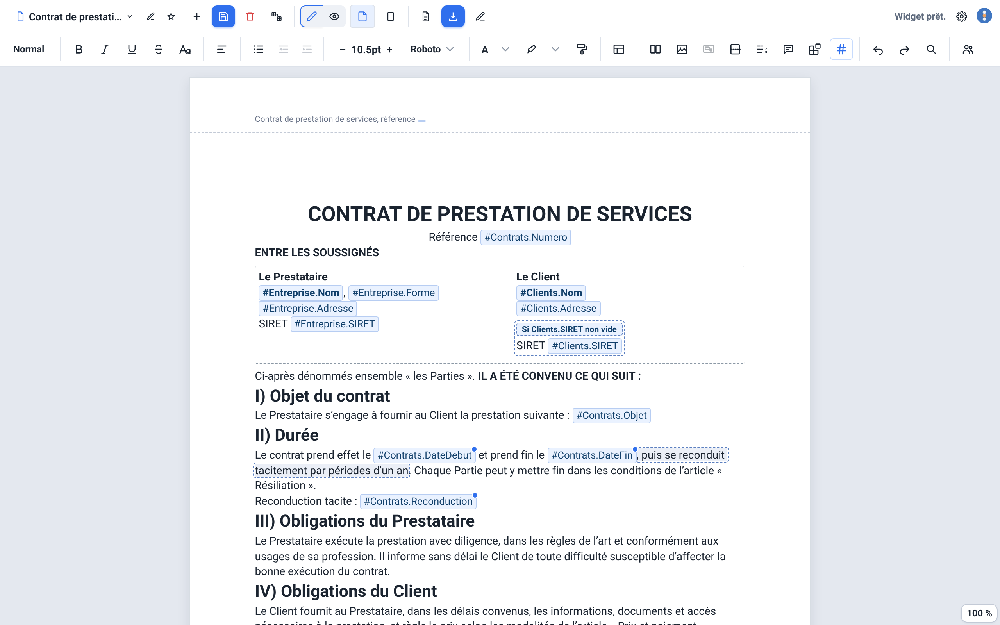

**Publipostage+ est un éditeur de texte complet pour [Grist](https://www.getgrist.com/), avec publipostage et puces intelligentes.** Vous rédigez contrats, factures, courriers ou étiquettes sans écrire la moindre ligne de code. Vous glissez dans le texte des **variables** qui viennent de n'importe quelle table du document (`#Table.Colonne`), vous les reformatez à l'affichage si besoin, puis vous lisez le document rempli avec une ligne de Grist et vous le téléchargez, ou vous l'envoyez par e-mail.

C'est un widget personnalisé conçu par [Grist Factory](https://grist-factory.fr), libre (GPL v3) et sans serveur : une simple page statique.

> **Version {{VERSION}}**, publiée le {{DATE_FR}}. Elle succède à la version 1.1.0 du 5 novembre 2026, qui suivait la première version stable, la 1.0.0 du 4 novembre : ce qui change est dans la [note de version](PATCH_NOTES.md), et la bêta reste servie à [une adresse à part](#installation-dans-grist).
> Essayez le widget sur une copie de votre document avant de l'utiliser sur des données importantes : des défauts peuvent subsister. Les [limites connues](#limites-connues) et la [roadmap](#roadmap) disent ce qui manque encore.

**[Installer](#installation-dans-grist)** · [Visite en images](#visite-en-images) · [Toutes les fonctions](#toutes-les-fonctions) · [Sécurité](#sécurité-et-permissions) · [Limites connues](#limites-connues) · [Contribuer](#contribuer)

## En bref

| | |
|---|---|
| **Écrire** | Un éditeur complet : mise en forme, tableaux, images, en-têtes et pieds de page, notes de bas de page, sommaire, aperçu A4 fidèle (ce que vous voyez est ce que vous obtenez). |
| **Remplir** | Des variables de toutes les tables du document, des conditions « Et » / « Ou », une mise en forme conditionnelle (couleur, fond, gras… selon la ligne), des boucles, des calculs et des puces (date du jour, heure, e-mail de la personne connectée). |
| **Lire** | Le document rempli avec la ligne choisie dans Grist, en lecture simple ou épurée. |
| **Exporter** | PDF vectoriel (le texte reste sélectionnable), PDF protégé, PDF/A (archivage), Word, Excel, Markdown, HTML, ou e-mail prérempli : une ligne à la fois ou en lot. |
| **Réutiliser** | Plusieurs modèles par document Grist, une galerie de 21 modèles prêts à l'emploi, des macro-modèles qui assemblent une page de garde et des annexes. |
| **Travailler à plusieurs** | Enregistrement automatique avec détection de conflit, historique des versions, commentaires, droits par personne. |

## Installation dans Grist

1. Dans une page Grist, ajoutez un widget personnalisé et collez cette adresse :
   **`https://grist-factory.github.io/Publipostage-Plus/`**
   (toute copie de ce dépôt hébergée en HTTPS sur un serveur statique convient aussi).
2. Dans le panneau de configuration du widget, réglez **Select by** (« Sélectionner par ») sur la table dont les lignes serviront de source de données. C'est ce réglage qui permet au widget de suivre la ligne sélectionnée : sans lui, le mode lecture n'a pas de ligne à remplir.
3. Grist demande une autorisation d'accès au chargement du widget : acceptez-la (voir [Sécurité et permissions](#sécurité-et-permissions)), elle est nécessaire au bon fonctionnement du widget.
4. Au premier lancement dans un document, le widget demande s'il peut y créer ses tables internes `Publipostage_*` (« Créer les tables du widget dans ce document ? »). Il faut donc avoir le droit de modifier le document. Refusé, rien n'est créé ni enregistré, et la question revient à l'action suivante. Ces tables sont rangées sous la page des modèles, repliée.
5. Après une mise à jour du widget, rechargez la page du document Grist, sans quoi le navigateur peut garder l'ancienne version.

Ouvert seul dans un onglet du navigateur, le widget ne fonctionne pas : il le dit et rappelle ces étapes.

**Premiers pas** : ouvrez le menu « Nouveau modèle » puis « Nouveau document » (ou « Créer à partir d'un modèle… » pour partir de la galerie), écrivez votre texte et tapez `#` pour insérer une variable. Passez en mode lecture pour voir le document rempli avec la ligne sélectionnée, puis exportez-le.

**Garder la bêta** : si un ancien modèle ne se rouvre pas bien dans la version actuelle, la bêta 1.0.0-beta.1 reste servie, telle quelle et sans correctif, à `https://grist-factory.github.io/Publipostage-Plus/beta/` (dans Grist, changez l'adresse du widget personnalisé). Le retour est sûr tant que le modèle n'a pas été enregistré avec la version actuelle : la bêta efface ce qu'elle ne connaît pas (signets, exposants et indices, « Sinon afficher »). Elle ne reçoit plus de mise à jour.

## Visite en images

Ces images montrent le vrai widget, avec des données fictives. L'interface est ici en français ; elle existe aussi en anglais. Cliquez sur une image pour l'agrandir.

### Lire le document rempli

Le même modèle, en mode lecture : chaque variable est remplacée par la valeur de la ligne sélectionnée dans Grist (ici, Atelier Lumière et Maison Berthier & Associés). Le bloc conditionnel « Si Clients.SIRET non vide » ne s'affiche que si le SIRET du client est renseigné.

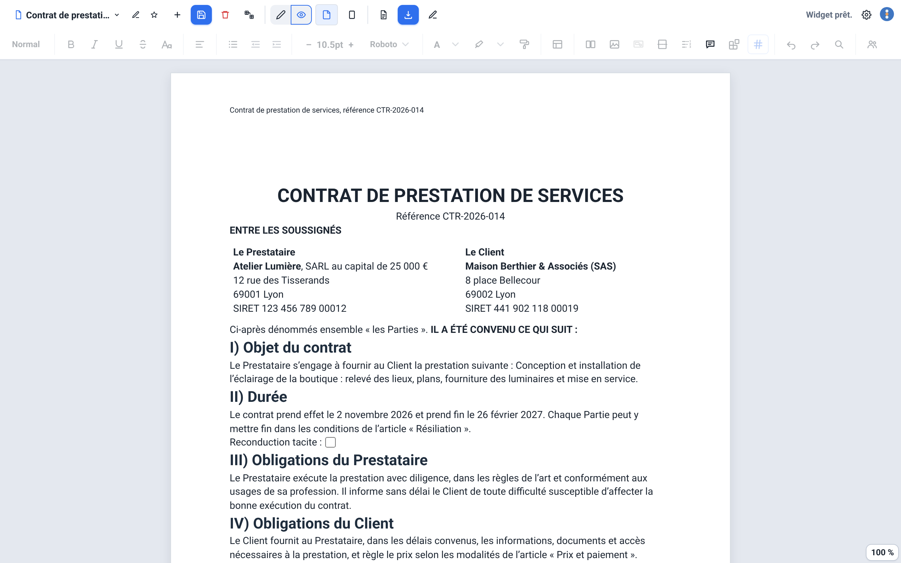

### Partir d'un modèle de la galerie

« Créer à partir d'un modèle… » propose 21 modèles prêts à l'emploi : facture, contrat, attestation, courrier de relance, quittance de loyer, bon de commande, bulletin scolaire, flyer, affiche, badge, carte de visite, étiquettes… Certains créent aussi les tables dont ils ont besoin.

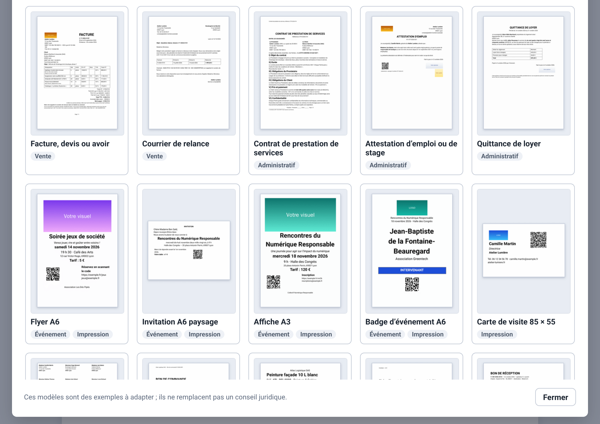

### Mettre en forme le texte

Le menu « Aa » règle le caractère (exposant, indice, petites capitales, ombre, contour, espacement des lettres) et la fenêtre « Paragraphe… » règle l'interligne, les espaces avant et après et les retraits, dont le retrait suspendu.

| Le menu « Aa » | La fenêtre « Paragraphe… » |
|---|---|
| 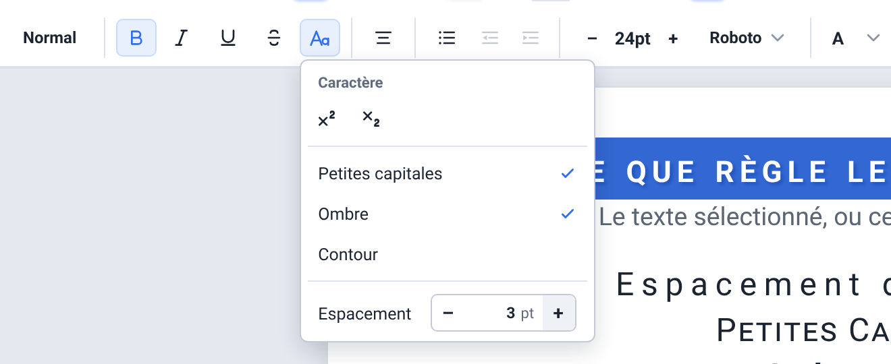 | 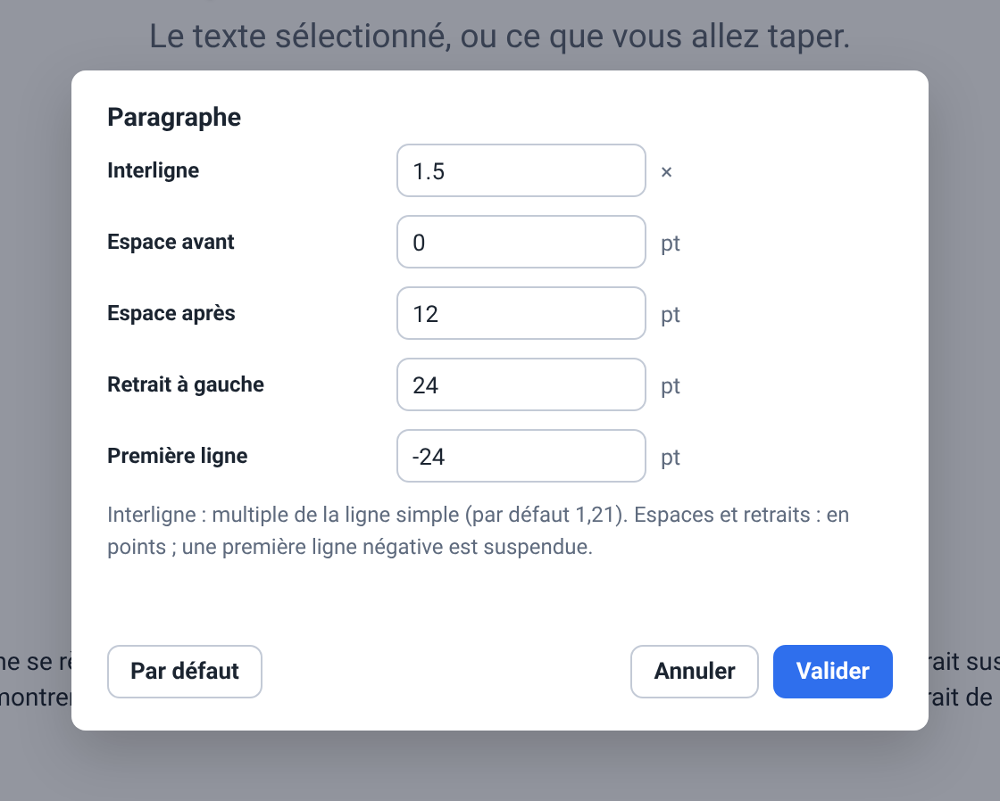 |

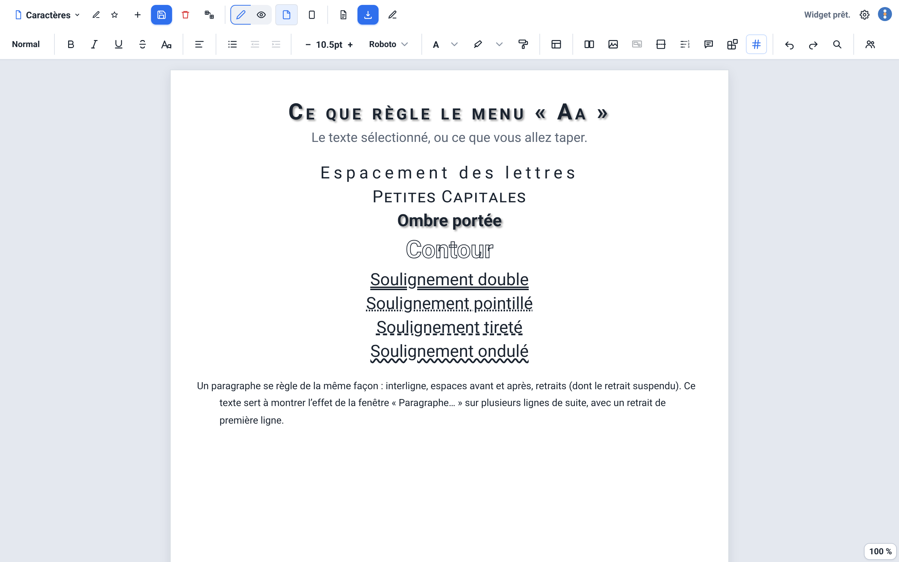

### Tableaux

Un tableau de document peut se lire « comme une grille » : lettres de colonnes, numéros de lignes, fusion de cases, bordures de la couleur voulue, alignement vertical.

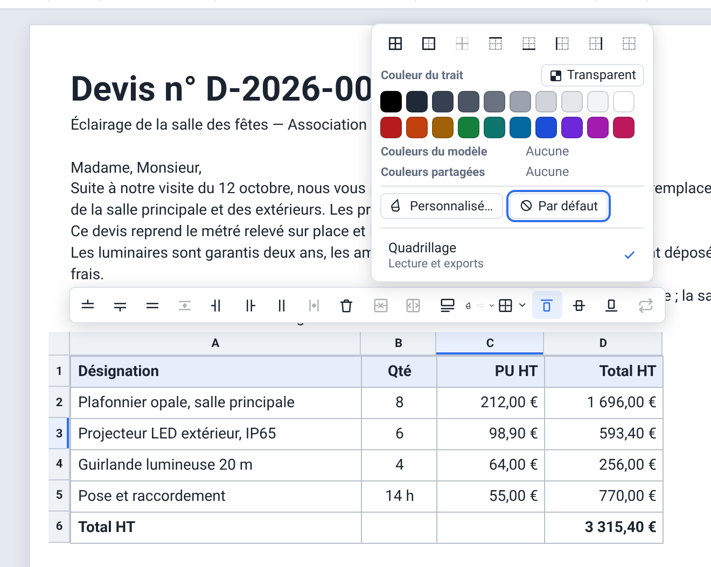

### Conditions et boucles

Une variable, un bloc de texte, une valeur dans la phrase ou une case cochée peuvent ne s'afficher que si des règles sont remplies, avec « Et » / « Ou », des groupes et un « Sinon afficher ». Une boucle répète une ligne de tableau, un élément de liste ou un paragraphe pour chaque ligne liée, avec filtre, tri et séparateurs.

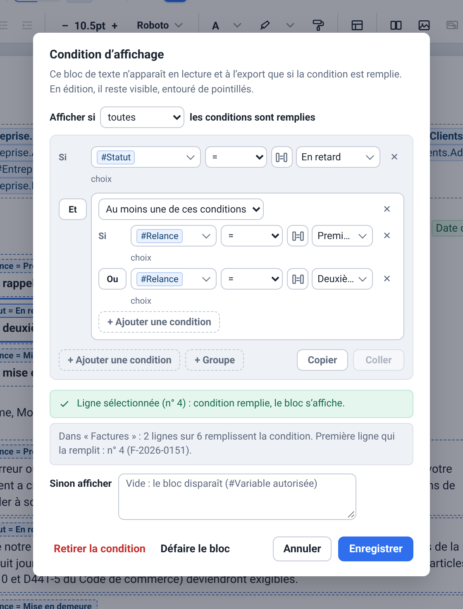

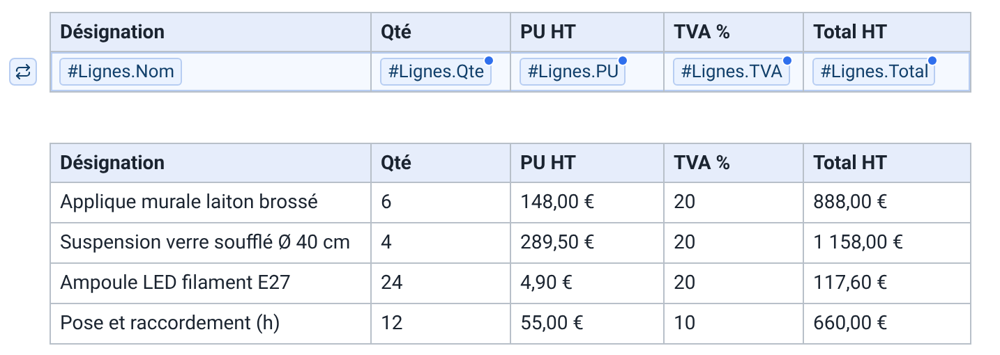

### Macro-modèles

Un macro-modèle assemble une page de garde toujours incluse et des annexes choisies par des règles sur la ligne. Portrait, paysage et grilles s'y mêlent, jusque dans le PDF.

| La composition | Le résultat en lecture |
|---|---|
| 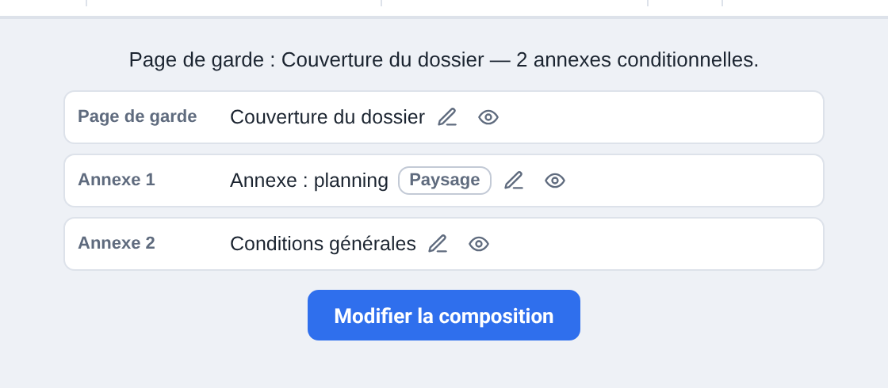 | 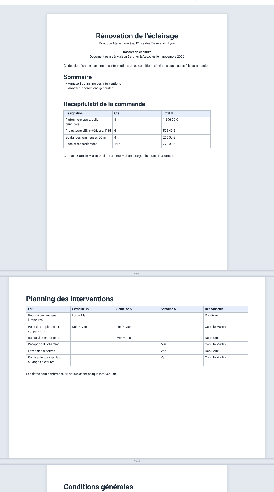 |

### Historique des versions

Chaque modèle garde ses versions : qui a changé quoi et quand. On compare avec la version actuelle (en vert ce que la version a en plus, en rouge barré ce qu'une restauration retirerait), on nomme une version pour qu'elle ne soit jamais effacée, on la restaure d'un clic.

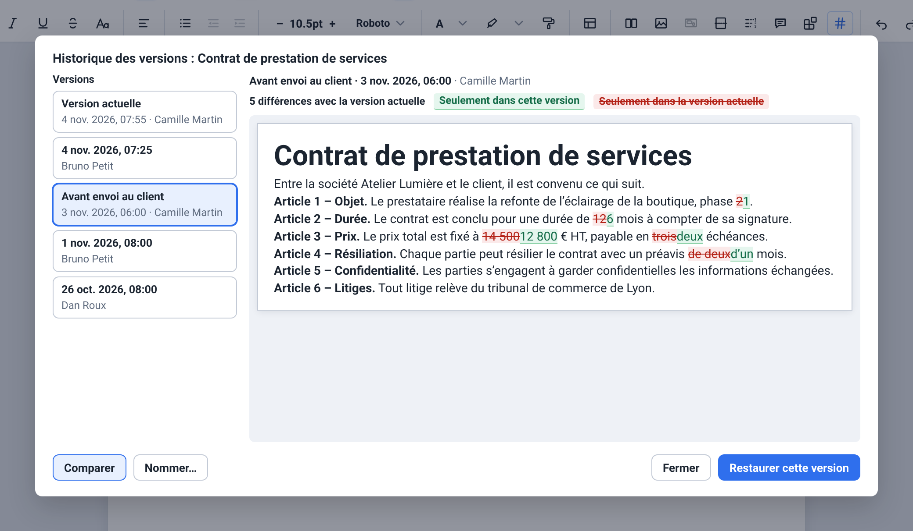

### Rechercher et remplacer

Avec casse, mot entier ou expression régulière (ici `(Prestataire|Client)` remplacé par `$1 (Partie)`) ; les bulles de variables et les en-têtes et pieds de page sont inclus.

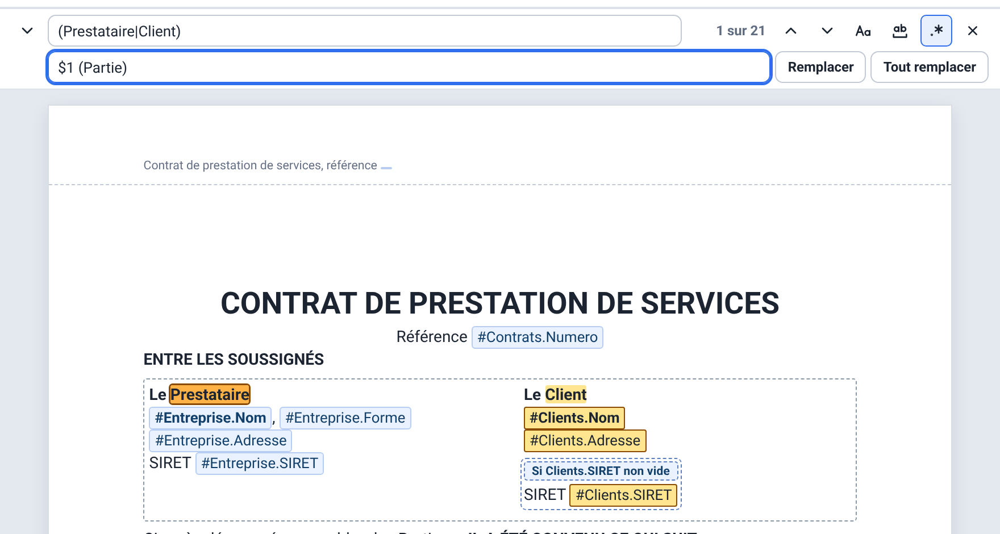

### Exporter

Le menu « Type d'export » propose PDF, PDF protégé, PDF/A (archivage), Word (bêta), Excel (pour les grilles), Markdown et HTML. L'assemblage avant impression pose les pages de chaque ligne sur des feuilles A4 ou A3, avec traits de coupe : quatre A6 sur une A4, par exemple.

| Le type d'export | L'assemblage avant impression |
|---|---|
| 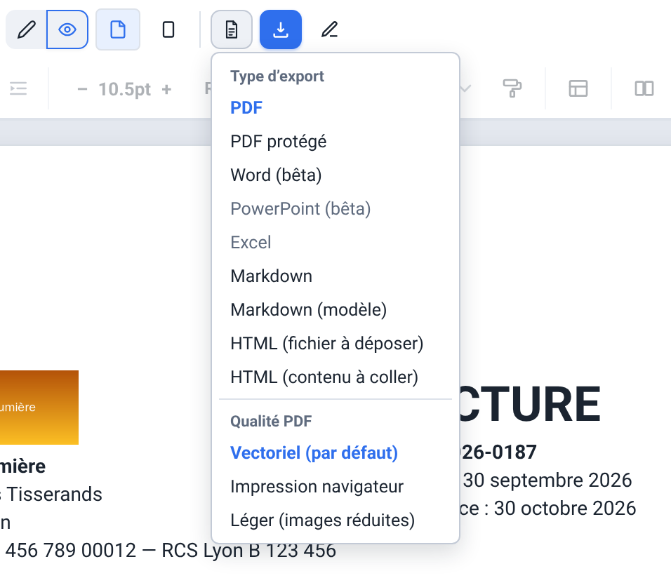 | 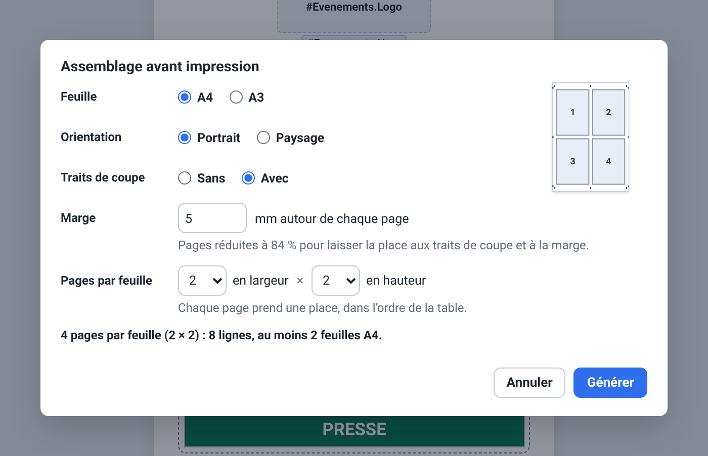 |

### Lire sans distraction

La lecture épurée montre le document seul, dans tout le panneau.

| Le menu Mode lecture | La lecture épurée |
|---|---|
| 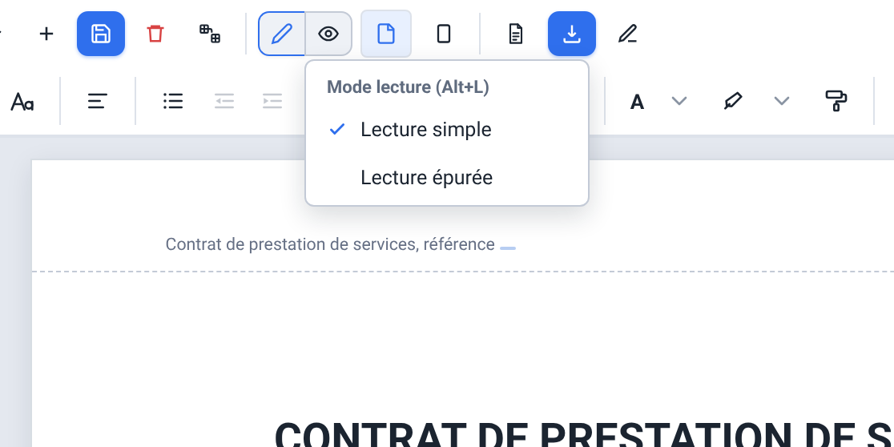 |  |

## Toutes les fonctions

La [note de version](PATCH_NOTES.md) en donne la liste complète, une puce par fonction. Voici l'essentiel, par domaine.

### Écrire

- **Texte** : gras, italique, souligné (simple, double, pointillé, tireté, ondulé), barré, exposant, indice, petites capitales, ombre, contour, espacement des lettres, couleur et surlignage, six polices de 8 à 72 points, pinceau de mise en forme.
- **Paragraphes** : alignements, texte de droite à gauche, retraits et tabulations, interligne, espaces avant et après, retrait suspendu.
- **Structure** : titres numérotés (dont « Article 1 »), un style par niveau de titre, sommaire cliquable, sauts de page, notes de bas de page, signets, filigrane.
- **Listes** à puces, numérotées et de tâches à cocher.
- **Tableaux** : fusion et scission de cases, bordures, alignement vertical, fond de case, légende, lettres et numéros comme dans une grille. Zones à deux colonnes.
- **Images** collées, ajoutées par adresse ou prises dans une colonne Pièces jointes de Grist (d'une table liée aussi, avec une condition d'affichage ou une boucle, une image par ligne liée ; un fichier qui n'est pas une image est remplacé par un message qui dit son nom) ; flottantes, devant ou derrière le texte, avec opacité et légende. Une image hébergée sur un autre site n'apparaît qu'après un clic sur « Afficher ».
- **En-têtes et pieds de page** (première page différente, numéro de page, QR code).
- **Blocs** : citation, bloc de code, encadré (Note, Attention, Important), bloc de signature, QR code.
- **Rechercher / remplacer** (casse, mot entier, expressions régulières), abréviations qui se développent à la frappe.
- **Confort** : aperçu A4 fidèle, zoom de la page, Ctrl+Z et Ctrl+Y presque partout, 62 raccourcis clavier personnalisables, barre d'outils pensée pour un petit panneau (testée à 700 × 400).

### Remplir avec les données de Grist

- **Variables** `#Table.Colonne` avec autocomplétion sur toutes les tables du document ; pour une table liée, une clé de correspondance à régler une fois, qui peut passer par plusieurs références (Badge › Nom prénom › Structure).
- **Fiches citées** : `@` ouvre la liste des lignes de toutes les tables (« Rédigé par @Marie Martin »). Le nom se relit à chaque affichage : renommer la personne dans Grist la renomme dans les modèles.
- **Mise en forme des variables** : nombres (écriture française ou américaine, décimales, devise, en toutes lettres), dates (formats prédéfinis, en toutes lettres, avec l'heure d'une colonne « Date et heure »), Oui / Non (texte ou case cochée). « Comme dans Grist » reprend le format de la colonne.
- **Puces intelligentes** : date du jour, heure, e-mail de la personne connectée, numéro de ligne d'une boucle, smiley (au choix dans une liste, qu'un clic change). **Calculs** : SOMME, MOYENNE, MIN, MAX, NB, ARRONDI.
- **Conditions** : « Et » / « Ou », groupes, « Sinon afficher », sur une variable, un bloc de texte, une valeur dans la phrase ou une case cochée.
- **Mise en forme conditionnelle** : une couleur de texte, un fond, du gras, de l'italique, du souligné ou du barré selon la ligne (« en rouge quand le montant dépasse 1 000 »), sur une variable, un calcul, un bloc de texte, une valeur dans la phrase ou une puce ; huit règles au plus, ou « Comme dans Grist » pour suivre en direct celles de la colonne dans Grist.
- **Boucles** sur les lignes liées, avec filtre, tri et séparateurs, y compris une boucle dans une boucle (les lignes de chaque facture, puis les étapes de chaque ligne) ou sur toutes les lignes d'une table.
- **Renommages suivis** : quand une table ou une colonne est renommée dans Grist, les modèles suivent.

### Les modèles

- **Quatre types** : Document (page A3, A4, A5 ou A6, portrait ou paysage, marges par modèle ; une page peut être tournée seule), E-mail (objet, destinataires et corps avec les mêmes variables, ouvert dans votre messagerie par un lien `mailto:`), Grille (un tableur à la place de la page : collage depuis Excel, Google Sheets ou LibreOffice Calc, import `.xlsx`, export Excel) et Macro-modèle.
- **Galerie** de 21 modèles prêts à l'emploi ; certains créent leurs tables, vides, avec leurs colonnes de calcul et leurs liens.
- **Plusieurs modèles par document Grist**, enregistrés dans le document lui-même, rangés avec des épingles et des dossiers que les autres personnes ne voient pas.
- **Import Markdown** (menu « + ») : un fichier `.md` devient un nouveau document, y compris un modèle exporté en « Markdown (modèle) ».

### Lire, enregistrer, collaborer

- **Mode lecture** simple ou épuré (Alt+L).
- **Enregistrement automatique** avec détection d'un conflit si quelqu'un d'autre a enregistré le modèle entre-temps.
- **Historique des versions** : aperçu, comparaison, nom, restauration (l'état remplacé reste dans la liste).
- **Commentaires** sur le texte sélectionné, avec réponses et résolution, partagés entre les personnes qui ouvrent le document.
- **Suivi des modifications** (bêta) : les changements sont proposés dans le texte, puis acceptés ou refusés. La mise en forme (gras, couleur, alignement, titres, listes) n'est suivie que si l'option « Suivre la mise en forme » du menu est allumée : éteinte, elle s'applique sans trace. La ligne « Liste des modifications » du même menu ouvre, à droite du texte, la liste de toutes les modifications en attente (qui, quand, un extrait), avec « Précédent » et « Suivant » pour les parcourir et « Accepter » et « Refuser » sur chaque ligne. À partir de deux personnes, chacune a sa couleur (un point devant chaque ligne), et un choix en tête de la liste ne garde que ses modifications, que « Accepter » et « Refuser » du bas résolvent d'un coup. La liste déroulante « Affichage » du volet propose quatre affichages du texte suivi : « Toutes les marques », « Marques simples » (le résultat final avec un trait à gauche de ce qui a changé), « Sans marque » (le résultat final) et « Original » (le texte d'avant) ; les trois derniers ne servent qu'à relire, le texte n'y est pas modifiable, et fermer le volet revient à « Toutes les marques ».
- **Droits par personne** (lecture seule, export, commentaires), lus dans une table du document : un verrou d'interface, pas une protection des données.

### Exporter

- **PDF vectoriel** : texte sélectionnable, polices embarquées, nom de fichier composé avec des variables. Trois qualités : « Vectoriel », « Impression par le navigateur » (la lecture imprimée page pour page par la fenêtre d'impression du navigateur) et PDF « Léger » (images ramenées à 150 points par pouce).
- **PDF protégé** : chiffré en AES-256, avec un mot de passe pour l'ouvrir (facultatif), des autorisations (imprimer, copier, modifier) et les propriétés du fichier.
- **PDF/A (archivage)** : le PDF vectoriel passé en PDF/A-2b, le format que les archives et les cabinets comptables demandent pour garder une facture lisible à l'identique des années plus tard (polices embarquées, description du document et profil de couleur sRGB ; mesuré conforme avec veraPDF). Une ligne, une archive ZIP ou un seul PDF ; un PDF/A ne se chiffre pas, c'est un type à part du PDF protégé, et l'assemblage avant impression comme l'impression par le navigateur n'y sont pas proposés.
- **En lot** : un PDF par ligne dans une archive ZIP, ou toutes les lignes dans un seul PDF. Un lot suit les lignes que le widget affiche dans Grist (filtres et tri compris) ; quand il n'en affiche qu'une partie, il demande s'il faut exporter celles-ci ou toute la table.
- **Assemblage avant impression** : les pages de chaque ligne sur des feuilles A4 ou A3, avec ou sans traits de coupe.
- **Date du dernier export** : une colonne de votre table, choisie dans Réglages > Vue, garde le moment du dernier export PDF de chaque ligne.
- **PDF joint à la ligne** : la case « Joindre à la ligne » du menu Exporter ajoute le PDF à la colonne Pièces jointes choisie dans Réglages > Vue, sur la ligne dont il vient (le PDF d'une ligne, ou chaque PDF d'une archive ZIP). Il est joint en plus d'être téléchargé.
- **Word** (`.docx`, bêta), **Excel** (`.xlsx`, pour les grilles), **Markdown** (`.md`, CommonMark et GFM, ou le modèle lui-même, variables comprises), **HTML** (une page complète, ou le seul contenu à coller dans un gestionnaire de contenu).
- **E-mail** prérempli par un lien `mailto:` (Standard ou Zimbra).
- Avant un export, une fenêtre liste les sites externes dont des images seraient téléchargées.

## Réglages

Le bouton **Réglages** de la barre du haut ouvre neuf onglets :

| Onglet | Rôle |
|---|---|
| Langue | Français ou English (celle du navigateur au premier lancement). |
| Thème | Système, clair ou sombre. |
| Insertion | La touche qui ouvre la liste des variables et des puces (`#` par défaut). |
| Raccourcis | Les touches du clavier, une par action, et les abréviations avec leur caractère déclencheur. |
| Email | La messagerie qui ouvre le lien du mode E-mail : Standard ou Zimbra. |
| Marges | Les marges du modèle ouvert, avec quatre préréglages (Aucune, Étroites, Classiques, Larges). |
| Vue | Le modèle par défaut de la vue, le choix du modèle selon la ligne, la colonne de la date du dernier export PDF, la colonne des PDF joints. |
| Accès | La table qui donne à chaque personne ses droits. |
| Crédits | Auteur, site, licence, version et nouveautés. |

Les réglages « Vue » et « Accès » sont des options du widget : Grist ne les partage avec les autres personnes qu'une fois la vue enregistrée. Deux gestes à connaître : le bouton « Tables liées » du panneau `#` règle une fois pour toutes la clé de correspondance entre deux tables, et un clic dans la marge du haut ou du bas de la page ouvre l'édition de l'en-tête ou du pied de page.

## Sécurité et permissions

**En résumé**

- Le widget demande l'**accès complet** au document Grist, faute de niveau intermédiaire dans l'API des widgets.
- Vos **données restent dans Grist** : page statique, aucun serveur, rien n'est stocké ailleurs.
- Il écrit dans ses propres tables `Publipostage_*`, **avec votre accord**, et dans aucune colonne de vos tables, sauf les deux que vous choisissez : celle de la date du dernier export et celle des PDF joints.
- Il charge des bibliothèques tierces, à versions figées, depuis quatre adresses (voir [Dépendances](#dépendances)).

### L'accès demandé

Le widget demande le niveau d'accès `requiredAccess: 'full'` : l'ensemble du document Grist, pas seulement la table à laquelle il est lié. C'est nécessaire dans l'architecture actuelle : la résolution de variables vers une autre table, l'autocomplétion sur tout le document et la gestion des tables internes du widget en ont besoin dès le chargement. L'API des widgets personnalisés de Grist ne propose pas de niveau entre l'accès à une seule table et l'accès complet.

Cet accès s'applique au widget, pas directement à chaque personne : les Règles d'accès natives de Grist, configurées sur le document par son propriétaire, continuent de s'appliquer. Une personne restreinte à certaines tables ou colonnes le reste en utilisant le widget. Une éventuelle restriction fine des données se fait donc dans le document Grist, pas dans la configuration du widget. Les « droits par personne » du widget (Réglages > Accès) ne sont qu'un verrou d'interface : ils grisent des commandes, ils ne protègent aucune donnée.

Pour la même raison, un mot de passe de PDF protégé écrit dans le document (« Le même pour tous, enregistré dans le document », ou les mots de passe d'une colonne avec « Un par ligne ») y est lisible en clair par toute personne qui ouvre le document, sauf permissions avancées de Grist sur cette colonne. « Saisi à chaque export » est la façon la plus sûre, et la fenêtre le dit.

### Ce que le widget écrit

Dans le document, le widget écrit dans neuf tables, toutes préfixées `Publipostage_`. Il ne les crée qu'avec l'accord de la personne : avant la première création, une fenêtre demande « Créer les tables du widget dans ce document ? » (« Créer les tables » ou « Ne pas créer »). Un oui vaut jusqu'à la fermeture de la page ; un refus n'écrit rien, n'est jamais gardé, et la question revient à l'action suivante. Un document qui porte déjà une table du widget ne pose aucune question.

| Table | Contenu |
|---|---|
| `Publipostage_Modeles` | Les modèles, et une ligne « Réglages du document » qui garde les couleurs partagées par tous les modèles et, seulement si vous choisissez « Le même pour tous, enregistré dans le document » pour un PDF protégé, ce mot de passe commun, en clair, dans sa colonne `MotDePassePdf`. |
| `Publipostage_Commentaires` | Les fils de commentaires. |
| `Publipostage_PreferencesModeles` | Les épingles, dossiers et choix d'export de chaque personne. |
| `Publipostage_Abreviations` | Les abréviations qui se développent à la frappe. |
| `Publipostage_FormatsPage` | Les formats de page enregistrés, partagés par tout le document. |
| `Publipostage_LiensTables` | Les clés de correspondance entre tables. |
| `Publipostage_Versions` | Les versions gardées de chaque modèle : créée à la première version gardée, lue seulement à l'ouverture de l'historique. |
| `Publipostage_Direct` | Le tuyau de l'écriture en direct, que seul Grist Factory Suite utilise (voir [À part](#à-part--grist-factory-suite)). |
| `Publipostage_UserProbe` | Sert à lire l'e-mail de la personne connectée. |

Dans les tables qui portent vos données, le widget n'écrit dans aucune colonne existante, sauf deux que vous choisissez dans Réglages > Vue, et seulement quand vous l'avez demandé. « Date du dernier export PDF » : il y écrit, après chaque PDF réussi, le moment de l'export pour les lignes dont le PDF vient d'être produit (une seule écriture par export). « PDF joint à la ligne » (une colonne de type Pièces jointes, cochée dans le menu Exporter) : il y ajoute le PDF de la ligne, ou remplace celui de même nom selon votre réglage, et laisse les autres pièces jointes de la cellule ; pour envoyer le fichier, il demande à Grist, à chaque export seulement, un jeton qui peut écrire dans le document, ne le garde pas et le jette à la fin de l'export. Sans colonne choisie, il n'écrit rien. Un compte Lecteur de Grist n'écrit rien.

### Bibliothèques externes et politique de sécurité

Le widget charge des bibliothèques tierces à l'exécution, depuis `esm.sh` (moteur d'édition TipTap/ProseMirror), `cdnjs.cloudflare.com` et `cdn.jsdelivr.net` (exports PDF, Word, Excel, lecteur de l'import Markdown et QR code, chargés au premier usage) et `docs.getgrist.com` (API de Grist), à des versions figées, sauf le script de l'API de Grist, que Grist sert dans sa version courante. Les fichiers venant de `cdnjs` et de `jsDelivr` sont protégés par une intégrité SRI, qui empêche le navigateur d'exécuter un fichier altéré ; ce n'est techniquement pas possible pour l'import map `esm.sh`. Aucune police ni feuille de style ne vient d'un autre site. Une vidéo YouTube ou Vimeo posée dans un modèle ne se charge qu'au clic sur ▶ : sans Grist Factory Suite, son lecteur est un cadre de `youtube-nocookie.com` ou de `player.vimeo.com`, les deux seuls cadres que la politique de sécurité autorise ; avec Grist Factory Suite, c'est lui qui joue le lecteur et l'app ne pose aucun cadre.

La page porte une politique de sécurité du contenu (CSP) : seuls s'exécutent les scripts du widget, ceux des adresses ci-dessus et trois scripts en ligne cités par leur empreinte. Les gestionnaires d'événements en ligne, les adresses `javascript:`, les cadres, les objets et les formulaires sont refusés. `'unsafe-eval'` y reste faute de mieux : le script d'API que sert Grist en a besoin. Le HTML d'un modèle relu depuis le document, qu'une autre personne a pu modifier, est assaini avant d'être affiché, et les formules de calcul ne passent jamais par `eval`.

### Images d'autres sites

Les images et les connexions ne sont pas limitées par la CSP : le widget lit des images et des pièces jointes de n'importe quel site. Mais une image hébergée sur un autre site que le widget ou Grist ne se charge qu'après un clic sur « Afficher » (dans l'éditeur, la lecture, les en-têtes et pieds de page et la galerie), car la charger apprend à ce site l'adresse IP de la personne et l'heure d'ouverture du document. Le clic affiche toutes les images de ce site jusqu'à la fermeture de la page, et rien n'est retenu, ni dans le navigateur ni dans le document. Avant un export qui téléchargerait de telles images, une fenêtre liste les sites et demande confirmation.

### Ce que garde le navigateur

Aucune donnée n'est stockée hors de Grist. Le navigateur ne garde (`localStorage`) que des préférences d'interface : la langue, le thème, la mise en forme des bulles et des puces dans l'éditeur, le rappel des images sans texte alternatif à l'export, l'info-bulle de valeur d'une variable, le dernier mode choisi (édition ou lecture), les touches, les raccourcis et la vue de leur panneau, la messagerie du mode E-mail, l'état de l'enregistrement automatique, l'option « Suivre la mise en forme » du suivi des modifications, le dernier choix de l'assemblage avant impression, la destination des PDF exportés, la case « Joindre à la ligne » du menu Exporter, les autorisations et l'auteur du PDF protégé, la façon de donner son mot de passe et la colonne des mots de passe (jamais un mot de passe), la dernière version dont la fenêtre des nouveautés a été fermée, le niveau de zoom de la page des derniers modèles ouverts, la liste courte des modèles dont la place des images devant ou derrière le texte a déjà été relue (des signatures, jamais le contenu d'un modèle) et, pour suivre les renommages, les noms des tables et des colonnes de chaque document ouvert. Aucune donnée de ligne n'y est copiée.

La fenêtre des nouveautés s'ouvre d'elle-même une fois par navigateur, à la première ouverture après une version qui en a. En navigation privée, ou si le stockage est refusé, seul le bouton « Voir les nouveautés » de Réglages > Crédits l'ouvre.

Pour signaler une vulnérabilité, merci de ne pas ouvrir d'issue publique : suivez [SECURITY.md](SECURITY.md).

## Dépendances

Aucune étape de build : tous les fichiers sont servis tels quels. Les bibliothèques tierces sont chargées à l'exécution, à des versions toujours figées (sauf le script de l'API de Grist) :

| Bibliothèque | Usage | Origine |
|---|---|---|
| `grist-plugin-api.js` | API du widget Grist (obligatoire) | `docs.getgrist.com` |
| TipTap 3.31.3 + ProseMirror (une quinzaine de paquets) + `@floating-ui/dom` 1.6.12 | Moteur d'édition riche | `esm.sh` |
| `@handlewithcare/prosemirror-suggest-changes` 0.1.8 | Suivi des modifications | `esm.sh` |
| pdfmake 0.2.7 + `vfs_fonts` | Export PDF vectoriel | `cdnjs.cloudflare.com` |
| pdf-lib 1.17.1 | Un seul PDF pour toutes les lignes, assemblage avant impression | `cdnjs.cloudflare.com` |
| JSZip 3.10.1 | Export en lot (archive ZIP) | `cdnjs.cloudflare.com` |
| ExcelJS 4.4.0 | Export Excel | `cdnjs.cloudflare.com` |
| qrcode-generator 1.4.4 | QR code | `cdnjs.cloudflare.com` |
| marked 15.0.12 | Import Markdown | `cdnjs.cloudflare.com` |
| docx 9.15.1 (+ `docx/charts`) | Export Word | `cdn.jsdelivr.net` |

L'interface prend la police du système. Les polices des documents sont dans le dépôt : Roboto pour l'éditeur, et pour le PDF Roboto, Arimo, Tinos, Cousine, Gelasio et Carlito, les équivalents libres de même métrique d'Arial, Times New Roman, Courier New, Georgia et Calibri. Les licences de toutes ces bibliothèques et polices sont dans [NOTICE](NOTICE).

## Limites connues

**Accès, réseau et sécurité**

- **Accès complet au document** : faute de niveau intermédiaire dans Grist, le widget demande `requiredAccess: 'full'` (voir [Sécurité et permissions](#sécurité-et-permissions)). Il n'existe pas de version avec les dépendances embarquées, pour éviter tout appel externe.
- **Réseau** : `esm.sh` (éditeur) et `docs.getgrist.com` (API de Grist) sont nécessaires au démarrage ; `cdnjs.cloudflare.com` et `cdn.jsdelivr.net` le sont au premier export ou au premier import Markdown. Un pare-feu qui bloque l'un d'eux empêche le widget de démarrer ou l'export de se faire : il faut les autoriser. Au démarrage, le widget le dit dans une fenêtre qui liste ces adresses.
- **Audit externe** : un outil d'audit de code, gwaudit, a analysé le widget le 4 octobre 2026, puis de nouveau le 4 novembre 2026 sur la V1. Son verdict est « NON CONFORME », avec 69 points bloquants à la dernière analyse de la V1, et tous viennent d'un seul choix : l'éditeur (TipTap et ProseMirror) se charge depuis `esm.sh`, un site tiers, sans contrôle d'intégrité SRI (cette vérification qu'un fichier venu d'un site tiers n'a pas été modifié, que le mécanisme de chargement de l'éditeur, un import map, ne permet pas ; voir [Dépendances](#dépendances)). Ce choix est conservé dans la version actuelle, donc le verdict reste « NON CONFORME ». Concrètement, l'outil juge qu'un hébergement sur une instance officielle (DINUM, ANCT) est exclu en l'état. Le widget reste installable ailleurs : à chaque personne de juger si ce risque convient à son usage.
- **Droits par personne** : un verrou d'interface, pas une protection des données (voir [Sécurité et permissions](#sécurité-et-permissions)).

**Navigateurs et travail à plusieurs**

- **Navigateurs** : les tests automatisés tournent sur Chromium (Chrome, Edge), avec un simulateur de Grist ; Firefox et Safari ne sont pas testés automatiquement.
- **Enregistrement** : deux personnes qui modifient le même modèle en même temps ne sont pas fusionnées. L'enregistrement automatique détecte qu'une autre personne a enregistré entre-temps et propose de recharger la dernière version ; le bouton « Enregistrer » écrase la version enregistrée sans le vérifier.
- **Suivi des modifications** (bêta) : la version complète reste à venir (voir la [roadmap](#roadmap)).
- **Accessibilité** : pas d'audit RGAA complet à ce jour ; les contrastes, le focus et les fenêtres (Tab, Échap) ont été travaillés.

**Exports**

- **PDF** : les caractères chinois, arabes, hébreux, thaï et la plupart des émojis ne sont pas pris en charge (une case vide les remplace) ; le grec, le cyrillique, le vietnamien, les flèches, coches, étoiles et monnaies le sont. L'« Impression par le navigateur » imprime une ligne à la fois, sur 60 pages au plus, et suppose que le navigateur ouvre sa fenêtre d'impression depuis le cadre du widget : si rien ne s'ouvre, choisissez « Vectoriel ». Un PDF protégé n'existe ni en un seul PDF pour toutes les lignes, ni en assemblage avant impression, ni par l'impression du navigateur (ces sorties ne se chiffrent pas) ; sans mot de passe pour l'ouvrir, ses autorisations (imprimer, copier, modifier) ne tiennent que chez les visionneuses qui les respectent.
- **Word** (bêta) : les images devant ou derrière le texte et celles alignées à gauche ou à droite y gardent leur place, le sommaire est un vrai sommaire Word dont les numéros de page ne s'écrivent que quand Word le met à jour, et les polices ne sont pas embarquées.
- **E-mail** : le corps est du texte brut (l'éditeur d'un modèle e-mail n'écrit ni gras, ni couleur, ni niveau de titre, ni image), sans pièce jointe ; le lien `mailto:` est limité à environ 2 000 caractères, une jauge prévient quand il les dépasse.
- **Excel** : le fichier contient des valeurs, jamais de formule.
- **Import Markdown** : seules les variables écrites `{{Table.Colonne}}` sont reconnues (un `#Table.Colonne` écrit à la main dans le fichier reste du texte) ; la numérotation des titres, écrite dans leur texte par l'export (« 1) Titre »), revient comme du texte ; les marges, le format de page, le filigrane, le style des niveaux de titre, l'objet et les destinataires d'un e-mail ne sont pas écrits dans un fichier Markdown, donc ne reviennent pas ; une image qui n'est ni en ligne ni dans le fichier n'est pas reprise ; un fichier de plus de 10 Mo est refusé. Le lecteur lit des fichiers de confiance : un texte fait pour le piéger (des milliers de crochets ou d'étoiles jamais fermés) peut bloquer la page de longues secondes.

**Contenu**

- **Modèles de la galerie** : ce sont des exemples de mise en page, écrits pour le droit français. Ils ne constituent ni un avis ni un conseil juridique et ne sont pas garantis conformes à la loi en vigueur (mentions obligatoires, pénalités de retard, clauses…) : faites-les relire avant tout usage.
- **Pas encore faits** : remplissage des tables d'un modèle avec des lignes d'exemple (l'aperçu de la galerie en montre en images, mais les tables créées restent vides), variantes multilingues d'un modèle, codes-barres (le QR code est livré).

## À part : Grist Factory Suite

Publipostage+ peut aussi tourner dans Grist Factory Suite (GFS), la suite d'applications de Grist Factory. Les présentations, les graphiques, l'écriture en direct et la lecture de PDF y sont réservés, car ils demandent des bibliothèques en plus : le widget seul ne les charge pas et grise leurs commandes, avec une fenêtre qui renvoie vers GFS. Ce document décrit le widget seul ; le détail de ces fonctions et leurs limites sont dans le [journal des changements](CHANGELOG.md).

## Note sur l'IA

Ce widget a été réalisé avec l'aide de Claude Code, avec le modèle Claude Sonnet 5 en mode Ultra Code. Le code a été relu par un humain (moi), mais je manque de tokens pour être aussi efficace que Claude.

Les prochaines versions seront aussi l'occasion de corriger ou refacto certains éléments si nécessaire : le dépôt est ouvert à la collaboration (voir [Contribuer](#contribuer)).

## Roadmap

De nombreuses fonctionnalités sont prévues et seront ajoutées progressivement dans les prochaines semaines. N'hésitez pas à réagir aux issues de ce dépôt, ou à m'écrire sur Tchap, pour m'aider à les prioriser.

**Édition collaborative**
- Suivi des modifications : version complète

**Édition augmentée**
- Codes-barres, en plus du QR code
- Remplissage d'un modèle avec des données d'exemple, pour le prévisualiser sans ligne réelle
- Modèles multilingues : variantes d'un même modèle

**Import / Export**
- Import Markdown : fiabilité à confirmer sur des exports réels de Docs de La Suite

**Confort d'utilisation**
- Optimisation du chargement

**Sécurité**
- Version lecture seule : préparer un modèle sur Docs, puis exporter/importer pour une session en lecture seule, avant export

## Contribuer

Les contributions sont bienvenues : signaler un défaut, proposer une fonction, envoyer une correction. Commencez par [CONTRIBUTING.md](CONTRIBUTING.md) ; le [code de conduite](CODE_OF_CONDUCT.md) s'applique à tous les échanges. Pour vous repérer dans le code (quel fichier fait quoi, par où commencer), lisez la [carte du code](CARTE_DU_CODE.md). Les changements de chaque version sont dans [CHANGELOG.md](CHANGELOG.md).

## Licence

Ce projet est distribué sous licence [GNU General Public License v3.0](LICENSE) (GPLv3).

Copyright (C) 2026 Grist Factory

Les bibliothèques et les polices tierces gardent leurs propres licences : voir [NOTICE](NOTICE). « Grist » est un produit de Grist Labs ; Publipostage+ est un widget tiers, qui n'est pas publié par Grist Labs.

---
---

# Publipostage+ for Grist

*🇫🇷 Une version française de ce document est disponible [en haut de cette page](#publipostage-pour-grist).*

**Publipostage+ is a full text editor for [Grist](https://www.getgrist.com/), with mail merge and smart chips.** You write contracts, invoices, letters or labels without writing a single line of code. You drop **variables** from any table of the document into the text (`#Table.Column`), reformat them on display if needed, then read the document filled with a row of Grist and download it, or send it by e-mail.

It is a custom widget made by [Grist Factory](https://grist-factory.fr), free software (GPL v3) with no server: a plain static page.

> **Version {{VERSION}}**, released on {{DATE_EN}}. It succeeds version 1.1.0 of November 5, 2026, which followed the first stable version, 1.0.0 of November 4: what changes is in the [release notes](PATCH_NOTES.md), and the beta is still served at [a separate address](#installing-in-grist).
> Try the widget on a copy of your document before using it on important data: defects may remain. The [known limitations](#known-limitations) and the [roadmap](#roadmap-1) say what is still missing.

**[Install](#installing-in-grist)** · [Tour in pictures](#tour-in-pictures) · [All the features](#all-the-features) · [Security](#security-and-permissions) · [Known limitations](#known-limitations) · [Contributing](#contributing)

## At a glance

| | |
|---|---|
| **Write** | A full editor: formatting, tables, images, headers and footers, footnotes, table of contents, a faithful A4 preview (what you see is what you get). |
| **Fill in** | Variables from every table of the document, "And" / "Or" conditions, conditional formatting (color, fill, bold… depending on the row), loops, calculations and chips (today's date, time, the connected user's e-mail). |
| **Read** | The document filled with the row selected in Grist, in standard or clean reading. |
| **Export** | Vector PDF (the text stays selectable), protected PDF, Word, Excel, Markdown, HTML, or a pre-filled e-mail: one row at a time or in batch. |
| **Reuse** | Several templates per Grist document, a gallery of 21 ready-to-use templates, macro templates that assemble a cover page and appendices. |
| **Work together** | Autosave with conflict detection, version history, comments, per-person rights. |

## Installing in Grist

1. In a Grist page, add a custom widget and paste this URL:
   **`https://grist-factory.github.io/Publipostage-Plus/`**
   (any copy of this repository hosted over HTTPS on a static server works too).
2. In the widget's configuration panel, set **Select by** to the table whose rows will be the data source. This is what lets the widget follow the selected row: without it, reading mode has no row to fill in.
3. Grist will ask for an access permission when the widget loads: grant it (see [Security and permissions](#security-and-permissions)), it is required for the widget to work.
4. On first launch in a document, the widget asks whether it may create its internal `Publipostage_*` tables there ("Create the widget's tables in this document?"), so you need the right to edit the document. Refused, nothing is created or saved, and the question comes back at the next action. These tables are filed under the templates page, collapsed.
5. After a widget update, reload the Grist document's page, otherwise the browser may keep the old version.

Opened alone in a browser tab, the widget does not work: it says so and recalls these steps.

**First steps**: open the "New template" menu then "New document" (or "Create from a template…" to start from the gallery), write your text and type `#` to insert a variable. Switch to reading mode to see the document filled with the selected row, then export it.

**Keeping the beta**: if an old template does not reopen well in the current version, the 1.0.0-beta.1 beta is still served, as it was and with no fixes, at `https://grist-factory.github.io/Publipostage-Plus/beta/` (in Grist, change the custom widget's address). Going back is safe as long as the template has not been saved with the current version: the beta erases what it does not know (bookmarks, superscripts and subscripts, "Otherwise show"). It no longer receives updates.

## Tour in pictures

These pictures show the real widget, with made-up data. The interface is shown in French here; it is also available in English. Click a picture to enlarge it.

### Reading the filled document

The same template, in reading mode: every variable is replaced by the value of the row selected in Grist (here, Atelier Lumière and Maison Berthier & Associés). The conditional block "If Clients.SIRET is not empty" only shows when the client's SIRET number is filled in.

### Starting from a gallery template

"Create from a template…" offers 21 ready-to-use templates: invoice, agreement, certificate, payment reminder letter, rent receipt, purchase order, school report, flyer, poster, badge, business card, labels… Some also create the tables they need.

### Formatting text

The "Aa" menu sets the character (superscript, subscript, small caps, shadow, outline, letter spacing) and the "Paragraph…" window sets line spacing, space before and after, and indents, including the hanging indent.

| The "Aa" menu | The "Paragraph…" window |
|---|---|
|  |  |

### Tables

A document table can be read "like a grid": column letters, row numbers, merged cells, borders of any color, vertical alignment.

### Conditions and loops

A variable, a text block, a value in a sentence or a checked box can show only when rules are met, with "And" / "Or", groups and an "Otherwise show". A loop repeats a table row, a list item or a paragraph for each linked row, with filter, sort and separators.

### Macro templates

A macro template assembles a cover page that is always included and appendices chosen by rules on the row. Portrait, landscape and grids can be mixed in it, down to the PDF.

| The composition | The result in reading mode |
|---|---|
|  |  |

### Version history

Each template keeps its versions: who changed what and when. You compare with the current version (green for what the version has in addition, struck-through red for what a restore would remove), name a version so it is never erased, and restore it in one click.

### Find and replace

With match case, whole word or regular expression (here `(Prestataire|Client)` replaced by `$1 (Partie)`); variable bubbles and headers and footers are included.

### Exporting

The "Export type" menu offers PDF, Protected PDF, PDF/A (archiving), Word (beta), Excel (for grids), Markdown and HTML. Sheet assembly before printing lays out each row's pages on A4 or A3 sheets, with crop marks: four A6 on one A4, for example.

| The export type | Sheet assembly before printing |
|---|---|
|  |  |

### Reading without distraction

Clean reading shows the document alone, across the whole panel.

| The Reading mode menu | Clean reading |
|---|---|
|  |  |

## All the features

The [release notes](PATCH_NOTES.md) give the complete list, one bullet per feature. Here is the essentials, by area.

### Writing

- **Text**: bold, italic, underline (single, double, dotted, dashed, wavy), strikethrough, superscript, subscript, small caps, shadow, outline, letter spacing, colors and highlighting, six fonts from 8 to 72 points, format painter.
- **Paragraphs**: alignment, right-to-left text, indents and tabs, line spacing, space before and after, hanging indent.
- **Structure**: numbered headings (including "Article 1"), a style per heading level, clickable table of contents, page breaks, footnotes, bookmarks, watermark.
- **Lists**: bullet, numbered and checkable task lists.
- **Tables**: merging and splitting cells, borders, vertical alignment, cell background, caption, letters and numbers like in a grid. Two-column zones.
- **Images** pasted, added by address or taken from a Grist Attachments column (from a linked table too, with a display condition or a loop, one image per linked row; a file that is not an image is replaced by a message that says its name); floating, in front of or behind the text, with opacity and caption. An image hosted on another site only appears after a click on "Show".
- **Headers and footers** (different first page, page number, QR code).
- **Blocks**: quote, code block, callout (Note, Warning, Important), signature block, QR code.
- **Find / replace** (match case, whole word, regular expressions), abbreviations that expand as you type.
- **Comfort**: faithful A4 preview, page zoom, Ctrl+Z and Ctrl+Y almost everywhere, 61 customizable keyboard shortcuts, a toolbar designed for a small panel (tested at 700 × 400).

### Filling in with Grist data

- **Variables** `#Table.Column` with autocomplete across every table in the document; for a linked table, a matching key to set up once, which can go through several references (Badge › Full name › Structure).
- **Cited records**: `@` opens the list of rows from every table ("Written by @Marie Martin"). The name is read again each time the document is shown: renaming the person in Grist renames them in templates.
- **Variable formatting**: numbers (French or US notation, decimals, currency, spelled out), dates (predefined formats, spelled out, with the time of a "Date and time" column), Yes / No (text or checked box). "Like in Grist" takes over the column's format.
- **Smart chips**: today's date, time, the connected user's e-mail, a loop's row number, an emoji (picked from a list, which a click changes). **Calculations**: SUM, AVERAGE, MIN, MAX, COUNT, ROUND.
- **Conditions**: "And" / "Or", groups, "Otherwise show", on a variable, a text block, a value in a sentence or a checked box.
- **Conditional formatting**: a text color, a fill, bold, italic, underline or strikethrough depending on the row ("in red when the amount exceeds 1,000"), on a variable, a calculation, a text block, a value in a sentence or a chip; at most eight rules, or "Like in Grist" to follow, live, the column's own rules in Grist.
- **Loops** over linked rows, with filter, sort and separators, including a loop inside a loop (the rows of each invoice, then the steps of each row) or over all the rows of a table.
- **Tracked renames**: when a table or a column is renamed in Grist, templates follow.

### Templates

- **Four types**: Document (A3, A4, A5 or A6 page, portrait or landscape, margins per template; a single page can be turned on its own), E-mail (subject, recipients and body with the same variables, opened in your mail client through a `mailto:` link), Grid (a spreadsheet in place of the page: paste from Excel, Google Sheets or LibreOffice Calc, import `.xlsx`, export to Excel) and Macro template.
- **Gallery** of 21 ready-to-use templates; some create their tables, empty, with their calculated columns and links.
- **Several templates per Grist document**, saved in the document itself, organized with pins and folders that other people don't see.
- **Markdown import** ("+" menu): a `.md` file becomes a new document, including a template exported as "Markdown (template)".

### Reading, saving, collaborating

- **Reading mode**, standard or clean (Alt+L).
- **Autosave** with conflict detection if someone else saved the template in the meantime.
- **Version history**: preview, comparison, naming, restoring (the replaced state stays in the list).
- **Comments** on the selected text, with replies and resolution, shared between the people who open the document.
- **Track changes** (beta): changes are proposed in the text, then accepted or rejected. Formatting (bold, color, alignment, headings, lists) is only tracked when the “Track formatting” option of the menu is on: when it is off, formatting applies without a trace. The “Changes list” row of the same menu opens, beside the text, the list of every pending change (who, when, an excerpt), with “Previous” and “Next” to walk through them and “Accept” and “Reject” on each line. From two people on, each has a colour (a dot before each line), and a choice at the top of the list keeps only that person's changes, which the “Accept” and “Reject” buttons at the bottom resolve in one go. The “Display” list of the pane offers four displays of the tracked text: “All markup”, “Simple markup” (the final text with a bar beside what changed), “No markup” (the final text) and “Original” (the text before the changes); the last three are for reading only, the text cannot be edited in them, and closing the pane goes back to “All markup”.
- **Per-person rights** (read-only, export, comments), read from a table of the document: an interface lock, not data protection.

### Exporting

- **Vector PDF**: selectable text, embedded fonts, file name built with variables. Three qualities: "Vector", "Browser print" (the Reading view printed page by page through the browser's print window) and Light PDF (images brought down to 150 points per inch).
- **Protected PDF**: encrypted with AES-256, with a password to open it (optional), permissions (print, copy, edit) and the file's properties.
- **PDF/A (archiving)**: the vector PDF turned into PDF/A-2b, the format archives and accounting firms ask for to keep an invoice readable exactly as it is years later (embedded fonts, document description and sRGB color profile; measured compliant with veraPDF). One row, a ZIP archive or a single PDF; a PDF/A cannot be encrypted, so it is a type apart from the protected PDF, and sheet assembly before printing and browser printing are not offered with it.
- **Batch**: one PDF per row in a ZIP archive, or all rows in a single PDF. A batch follows the rows the widget shows in Grist (filters and sort included); when it only shows part of the table, it asks whether to export those or the whole table.
- **Sheet assembly before printing**: each row's pages on A4 or A3 sheets, with or without crop marks.
- **Date of the last export**: a column of your table, chosen in Settings > View, keeps the moment of each row's last PDF export.
- **PDF attached to the row**: the “Attach to the row” box of the Export menu adds the PDF to the Attachments column chosen in Settings > View, on the row it comes from (a single row's PDF, or each PDF of a ZIP archive). It is attached in addition to being downloaded.
- **Word** (`.docx`, beta), **Excel** (`.xlsx`, for grids), **Markdown** (`.md`, CommonMark and GFM, or the template itself, variables included), **HTML** (a complete page, or the content alone to paste into a content manager).
- **E-mail** pre-filled through a `mailto:` link (Standard or Zimbra).
- Before an export, a window lists the external sites that images would be downloaded from.

## Settings

The **Settings** button in the top bar opens nine tabs:

| Tab | Purpose |
|---|---|
| Language | French or English (the browser's at first launch). |
| Theme | System, light or dark. |
| Insertion | The key that opens the list of variables and chips (`#` by default). |
| Shortcuts | The keyboard keys, one per action, and the abbreviations with their trigger character. |
| Email | The mail client that opens the E-mail mode link: Standard or Zimbra. |
| Margins | The open template's margins, with four presets (None, Narrow, Classic, Wide). |
| View | The view's default template, the choice of template by row, the column of the date of the last PDF export, the column of the attached PDFs. |
| Access | The table that gives each person their rights. |
| Credits | Author, site, license, version and what's new. |

The "View" and "Access" settings are widget options: Grist only shares them with other people once the view is saved. Two gestures worth knowing: the "Linked tables" button of the `#` panel sets the matching key between two tables once and for all, and a click in the top or bottom margin of the page opens the header or footer editing.

## Security and permissions

**In short**

- The widget requests **full access** to the Grist document, for lack of a middle level in the widgets API.
- Your **data stays in Grist**: a static page, no server, nothing is stored elsewhere.
- It writes to its own `Publipostage_*` tables, **with your consent**, and to no column of your tables, except the two you choose: the one for the date of the last export and the one for the attached PDFs.
- It loads third-party libraries, at pinned versions, from four addresses (see [Dependencies](#dependencies)).

### The access requested

The widget requests `requiredAccess: 'full'`: the whole Grist document, not just the table it is linked to. This is needed by the current architecture: resolving variables from another table, autocompleting across the whole document and managing the widget's own internal tables all need it from the moment the widget loads. Grist's custom widget API doesn't offer a middle ground between single-table access and full access.

This access applies to the widget, not directly to each person: Grist's native Access Rules, set on the document by its owner, still apply as normal. A person restricted to certain tables or columns stays restricted while using the widget. Any fine-grained restriction of the data should therefore happen in the Grist document, not in the widget's configuration. The widget's "per-person rights" (Settings > Access) are only an interface lock: they grey out commands, they don't protect any data.

For the same reason, a protected PDF's password written in the document ("Same for all, saved in the document", or the passwords of a column with "One per row") can be read there in plain text by anyone who opens the document, unless advanced Grist permissions cover that column. "Typed at each export" is the safest way, and the window says so.

### What the widget writes

In the document, the widget writes to nine tables, all prefixed `Publipostage_`. It only creates them with the person's consent: before the first creation, a window asks "Create the widget's tables in this document?" ("Create the tables" or "Don't create"). A yes holds until the page is closed; a refusal writes nothing, is never remembered, and the question comes back at the next action. A document that already has one of the widget's tables is never asked.

| Table | Content |
|---|---|
| `Publipostage_Modeles` | The templates, and a "Réglages du document" row that keeps the colors shared by every template and, only if you choose "Same for all, saved in the document" for a protected PDF, that shared password, in plain text, in its `MotDePassePdf` column. |
| `Publipostage_Commentaires` | The comment threads. |
| `Publipostage_PreferencesModeles` | Each person's pins, folders and export choices. |
| `Publipostage_Abreviations` | The abbreviations that expand as you type. |
| `Publipostage_FormatsPage` | The saved page formats, shared by the whole document. |
| `Publipostage_LiensTables` | The matching keys between tables. |
| `Publipostage_Versions` | The versions kept for each template: created when the first version is kept, only read when the history is opened. |
| `Publipostage_Direct` | The pipe of live editing, which only Grist Factory Suite uses (see [Set apart: Grist Factory Suite](#set-apart-grist-factory-suite)). |
| `Publipostage_UserProbe` | Used to read the connected user's e-mail. |

In the tables that hold your data, the widget writes to no existing column, except two that you choose in Settings > View, and only when you asked for it. "Date of the last PDF export": it writes there, after each successful PDF, the moment of the export for the rows whose PDF has just been made (a single write per export). "PDF attached to the row" (an Attachments column, ticked in the Export menu): it adds the row's PDF there, or replaces the one with the same name according to your setting, and leaves the cell's other attachments alone; to send the file, it asks Grist, for each export only, for a token that can write to the document, does not keep it and drops it at the end of the export. With no column chosen, it writes nothing. A Grist Viewer account writes nothing.

### External libraries and security policy

The widget loads third-party libraries at runtime, from `esm.sh` (the TipTap/ProseMirror editing engine), `cdnjs.cloudflare.com` and `cdn.jsdelivr.net` (PDF, Word and Excel exports, the Markdown import reader and QR code, loaded on first use) and `docs.getgrist.com` (the Grist API), at pinned versions, except the Grist API script, which Grist serves in its current version. Files from `cdnjs` and `jsDelivr` are protected by SRI integrity hashes, which stop the browser from running a tampered file; this isn't technically possible for the `esm.sh` import map. No font or stylesheet comes from another site. A YouTube or Vimeo video placed in a template is only loaded when ▶ is clicked: without Grist Factory Suite, its player is a frame from `youtube-nocookie.com` or `player.vimeo.com`, the only two frames the content security policy allows; with Grist Factory Suite, it plays the player itself and the app places no frame.

The page carries a Content Security Policy (CSP): only the widget's own scripts, those of the addresses above and three inline scripts cited by their hash are allowed to run. Inline event handlers, `javascript:` addresses, frames, objects and forms are refused. `'unsafe-eval'` remains for lack of a better option: the API script that Grist serves needs it. The HTML of a template read back from the document, which another person may have edited, is sanitized before being displayed, and calculation formulas never go through `eval`.

### Images from other sites

Images and connections are not limited by the CSP: the widget reads images and attachments from any site. Still, an image hosted on a site other than the widget's or Grist's only loads after a click on "Show" (in the editor, Reading mode, headers and footers and the gallery), because loading it tells that site the person's IP address and when the document was opened. The click shows every image from that site until the page is closed, and nothing is remembered, neither in the browser nor in the document. Before an export that would download such images, a window lists the sites and asks for confirmation.

### What the browser keeps

No data is ever stored outside of Grist. The only things kept in the browser (`localStorage`) are interface preferences: the language, the theme, the formatting of bubbles and chips in the editor, the reminder about images without alternative text on export, the variable value tooltip, the last mode chosen (edit or read), the keys, the shortcuts and the view of their panel, the mail program of the Email mode, the autosave state, the “Track formatting” option of track changes, the last choice in the sheet assembly before printing, the PDF destination, the “Attach to the row” box of the Export menu, the permissions and author of the protected PDF, the way its password is given and the password column (never a password), the last version whose news window was closed, the page zoom level of the last templates opened, a short list of the templates whose images in front of or behind the text have already had their position checked (signatures, never a template's content) and, to follow renames, the names of the tables and columns of each open document. No row data is ever copied there.

The news window opens by itself once per browser, the first time the widget is opened after a version that has news. In a private window, or where the storage is refused, only the "See what's new" button of Settings > Credits opens it.

To report a vulnerability, please don't open a public issue: follow [SECURITY.md](SECURITY.md).

## Dependencies

No build step: every file is served as-is. Third-party libraries are loaded at runtime, always at pinned versions (except the Grist API script):

| Library | Purpose | Source |
|---|---|---|
| `grist-plugin-api.js` | Grist widget API (required) | `docs.getgrist.com` |
| TipTap 3.31.3 + ProseMirror (about fifteen packages) + `@floating-ui/dom` 1.6.12 | Rich text editing engine | `esm.sh` |
| `@handlewithcare/prosemirror-suggest-changes` 0.1.8 | Track changes | `esm.sh` |
| pdfmake 0.2.7 + `vfs_fonts` | Vector PDF export | `cdnjs.cloudflare.com` |
| pdf-lib 1.17.1 | Single PDF for all rows, sheet assembly before printing | `cdnjs.cloudflare.com` |
| JSZip 3.10.1 | Batch export (zip archive) | `cdnjs.cloudflare.com` |
| ExcelJS 4.4.0 | Excel export | `cdnjs.cloudflare.com` |
| qrcode-generator 1.4.4 | QR code | `cdnjs.cloudflare.com` |
| marked 15.0.12 | Markdown import | `cdnjs.cloudflare.com` |
| docx 9.15.1 (+ `docx/charts`) | Word export | `cdn.jsdelivr.net` |

The interface uses the system font. The documents' fonts are in the repository: Roboto for the editor, and for the PDF Roboto, Arimo, Tinos, Cousine, Gelasio and Carlito, the free metric-compatible equivalents of Arial, Times New Roman, Courier New, Georgia and Calibri. The licenses of all these libraries and fonts are in [NOTICE](NOTICE).

## Known limitations

**Access, network and security**

- **Full access to the document**: for lack of a middle level in Grist, the widget requests `requiredAccess: 'full'` (see [Security and permissions](#security-and-permissions)). There is no version with bundled dependencies to avoid any external call.
- **Network**: `esm.sh` (editor) and `docs.getgrist.com` (Grist API) are needed at startup; `cdnjs.cloudflare.com` and `cdn.jsdelivr.net` are needed at the first export or the first Markdown import. A firewall that blocks one of them prevents the widget from starting or the export from working: they must be allowed. At startup, the widget says so in a window that lists these addresses.
- **External audit**: a code audit tool, gwaudit, analysed the widget on October 4, 2026, then again on November 4, 2026 on the V1. Its verdict is "NON CONFORME" (non-compliant), with 69 blocking points in the latest analysis of the V1, and they all come down to one choice: the editor (TipTap and ProseMirror) is loaded from `esm.sh`, a third-party site, without an SRI integrity check (the check that a file fetched from a third-party site has not been altered, which the editor's loading mechanism, an import map, doesn't allow; see [Dependencies](#dependencies)). That choice is kept in the current version, so the verdict stays "NON CONFORME". In practice, the tool rules out hosting the widget on an official instance (DINUM, ANCT) as it stands. The widget remains installable elsewhere: it is up to each person to judge whether this risk suits their use.
- **Per-person rights**: an interface lock, not data protection (see [Security and permissions](#security-and-permissions)).

**Browsers and working together**

- **Browsers**: automated tests run on Chromium (Chrome, Edge), with a Grist simulator; Firefox and Safari are not tested automatically.
- **Saving**: two people editing the same template at the same time are not merged. Autosave detects that someone else saved in the meantime and offers to reload the latest version; the "Save" button overwrites the saved version without checking.
- **Track changes** (beta): the complete version is still to come (see the [roadmap](#roadmap-1)).
- **Accessibility**: no full RGAA audit to date; contrasts, focus and windows (Tab, Esc) have been worked on.

**Exports**

- **PDF**: Chinese, Arabic, Hebrew and Thai characters and most emoji are not supported (an empty box replaces them); Greek, Cyrillic, Vietnamese, arrows, check marks, stars and currencies are. "Browser print" prints one row at a time, up to 60 pages, and assumes the browser opens its print window from the widget's frame: if nothing opens, choose "Vector". A protected PDF does not exist as a single PDF for all rows, as a sheet assembly or through browser print (those outputs cannot be encrypted); with no password to open it, its permissions (print, copy, edit) only bind the viewers that honour them.
- **Word** (beta): images in front of or behind the text, and images aligned left or right, keep their place; the table of contents is a real Word table of contents whose page numbers are written only when Word updates it, and fonts are not embedded.
- **E-mail**: the body is plain text (the editor of an e-mail template writes no bold, colour, heading level or image), with no attachment; the `mailto:` link is limited to about 2,000 characters, and a gauge warns when it goes over.
- **Excel**: the file holds values, never formulas.
- **Markdown import**: only variables written `{{Table.Column}}` are recognized (a `#Table.Column` typed by hand in the file stays text); the heading numbering, written in their text by the export ("1) Title"), comes back as text; margins, page format, watermark, the heading level styles, and an e-mail's subject and recipients are not written in a Markdown file, so they do not come back; an image that is neither online nor in the file is not imported; a file over 10 MB is refused. The reader is meant for trusted files: a text built to trap it (thousands of brackets or asterisks never closed) can freeze the page for long seconds.

**Content**

- **Gallery templates**: these are layout examples, written for French law. They are neither legal advice nor guaranteed to comply with current law (mandatory mentions, late-payment penalties, clauses…): have them reviewed before any real use.
- **Not done yet**: filling a template's tables with sample rows (the gallery preview shows some as images, but the tables created stay empty), multilingual variants of a template, barcodes (the QR code is delivered).

## Set apart: Grist Factory Suite

Publipostage+ can also run inside Grist Factory Suite (GFS), Grist Factory's suite of applications. Presentations, charts, live editing and PDF reading are reserved to it, because they need extra libraries: the widget alone does not load them and greys out their commands, with a window that points to GFS. This document describes the widget alone; the detail of those features and their limits is in the [changelog](CHANGELOG.md).

## A note on AI

This widget was built with the help of Claude Code, using the Claude Sonnet 5 model in Ultra Code mode. The code was reviewed by a human (me), but I don't have enough tokens to be as thorough as Claude.

Upcoming releases will also be a chance to fix or refactor certain parts if needed: this repository is open to collaboration (see [Contributing](#contributing)).

## Roadmap

Plenty of features are planned and will be rolled out gradually over the coming weeks. Feel free to react to this repository's issues, or write to me on Tchap, to help me prioritize them.

**Collaborative editing**
- Track changes: complete version

**Enhanced editing**
- Barcodes, in addition to the QR code
- Filling a template with sample data, to preview it without a real row
- Multilingual templates: variants of the same template

**Import / export**
- Markdown import: reliability to be confirmed on real La Suite Docs exports

**Quality of life**
- Loading time optimization

**Security**
- Read-only version: prepare a template in Docs, then export/import for a read-only session, before exporting

## Contributing

Contributions are welcome: reporting a defect, suggesting a feature, sending a fix. Start with [CONTRIBUTING.md](CONTRIBUTING.md); the [code of conduct](CODE_OF_CONDUCT.md) applies to every exchange. To find your way around the code (which file does what, where to start), read the [code map](CARTE_DU_CODE.md#publipostage-code-map). The changes of each version are in [CHANGELOG.md](CHANGELOG.md).

## License

This project is distributed under the [GNU General Public License v3.0](LICENSE) (GPLv3).

Copyright (C) 2026 Grist Factory

Third-party libraries and fonts keep their own licenses: see [NOTICE](NOTICE). "Grist" is a product of Grist Labs; Publipostage+ is a third-party widget, not published by Grist Labs.
